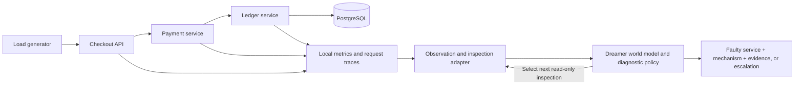

> Status, 9 November 2026: live lab and development evaluation implemented.
> The inspect-first world-model controller achieved 48/48 known-case diagnoses
> across two development batches. Fresh-seed confirmation passed at 99.2–100%
> per model across 120 physical incidents (360 model evaluations). Unknown
> combined faults are not reliably recognized. See README and the live protocol
> for current evidence; the original plan below is retained as design context.

# Microservice triage MVP

Proposed next stage after the confirmed synthetic POC. This document is a design;
no microservices have been deployed or evaluated yet.

## Goal

Diagnose the faulty service and failure mechanism from real requests, telemetry,
and selected inspections in a small BearBank-style estate. The decisive scenario
is an upstream payment/checkout latency alarm caused by a downstream ledger fault.

Use real HTTP calls and database operations. Start with minimal independently
owned services in this repository, inspired by BearBank's topology. Existing
BearBank images, GitOps repositories, ingest credentials and AutoSRE backends are
not dependencies. No change to bearbank-default, bearbank-acme-corp or AutoSRE.

## Smallest useful scenarios

| Scenario | Actual intervention | Required diagnosis |
|---|---|---|
| Healthy and traffic increase | Vary bounded request rate without changing service configuration | Healthy/load pressure, without inventing a fault |
| Payment CPU bottleneck | Bounded request-path CPU work in payment | Payment: CPU contention |
| Ledger pool starvation | Restrict real database connection availability under concurrent requests | Ledger: connection-pool contention |
| Downstream delay cascade | Add bounded delay to ledger requests | Ledger: downstream delay, despite upstream symptoms |

Fault injection is controlled by a separate experiment runner. Scenario names,
injection settings and ground-truth labels never enter policy observations.
Measurements must reflect actual operations, not be manufactured from fault IDs.
Reset each incident and verify recovery before starting another.

## What the agent sees and does

Give the agent time-windowed request rate, latency and error summaries, service
identity and freshness/missingness indicators. Detailed CPU, connection-pool wait
and request-path timing are revealed by explicit read-only inspection actions.
Bound the action set: inspect a service/resource or trace path, wait, submit a
service-plus-mechanism diagnosis, or escalate. Log every observation and action.

Retain the existing Dreamer implementation, training machinery and particle-vote
controller as starting points. The current nine-feature checkpoint is not a
ready-made microservice model: the richer observation/action contract requires
adaptation and training. A correct diagnosis must cite measured evidence; particle
agreement alone is not a calibrated confidence score.

## Fast learning path without hiding the transfer problem

1. Deploy services, local telemetry and a bounded load/fault runner. Establish
   reproducible healthy/faulty traces and a telemetry-based checklist baseline.
2. Collect a limited training dataset from real episodes. Use those measurements
   to build/calibrate a fast training environment for the expanded task. Record
   which data are real and which are simulated.
3. Train Dreamer in that fast environment, then freeze weights and preprocessing.
   Evaluate against live services under separately held-out loads and fault
   intensities. If transfer fails, record the result and adapt using separate
   training episodes; reserve new confirmation episodes before retesting.
4. Produce a CLI incident timeline: alarm, selected checks, root-cause diagnosis,
   evidence and elapsed time. Add a UI or LLM explanation only after this works.

Training directly for 100,000 real-time steps could dominate runtime. Fast
simulation is a training aid, never a substitute for the final live-service test.
Do not present replay scoring or simulator accuracy as live triage success.

## Proposed acceptance gate (freeze before live confirmation)

Use whole-incident splits, never random windows from the same incident. Reserve
loads, fault intensities and random seeds not used for calibration or tuning.
Evaluate at least 30 episodes per known condition for each of three training
seeds, in bounded batches. Confirm the episode duration and compute budget in a
pilot before committing to the full batch.

- At least 90% exact service-plus-mechanism accuracy for known faults per seed.
- At most 5% false incident diagnoses in healthy/load-only episodes per seed.
- At least 90% correct localization for the downstream cascade case per seed.
- At most three diagnostic inspections per incident on average; target median
  diagnosis time below 60 seconds after the incident trigger.
- Include separate unfamiliar/combined-fault cases and report escalation and
  false certainty; do not claim open-world reliability from known classes.
- Compare against a topology-aware checklist with the same telemetry/action
  access. Report accuracy, inspection count, wall time and inference compute;
  an advantage over expert rules is a separate empirical claim.

## Isolation and delivery

Keep all services, database, telemetry, data and experiment jobs in
systems-world-model-lab. Retain the aggregate four-CPU / 6 GiB cap; budget the
services and trainer together, and separate collection/training phases where
needed. The current three-pod quota must be raised for the extra components,
without increasing aggregate CPU/memory limits. Use default-deny policies with
explicit internal service flows and narrowly scoped DNS, no cross-namespace
application access, non-root containers and no credentials in agent pods.
Use bounded injection durations, workload limits and automatic fault reset.

Deliver runnable manifests, service code, the real observation adapter,
reproducible episode data, checkpoints, a diagnosis demo and an updated report.
Automatic repair, Slack/GitHub integration and LLM remediation are later stages.

## Local design references

BearBank topology and cascade behavior were inspected in AutoSRE's
`demo/bearbank/topology.py` and `demo/bearbank/scenarios.py`. Its existing scenario
driver writes tenant GitOps repositories, so it must not be run for this lab.
The new runner must address only the standalone experiment services.
