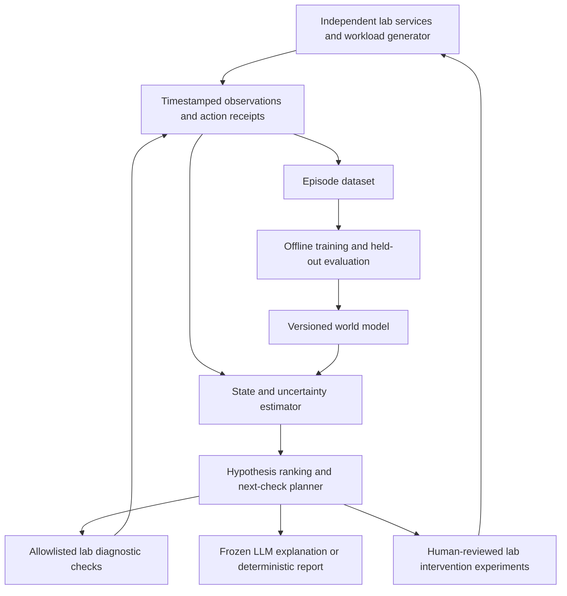

# World models for system triage: independent MVP plan

Date: 2026-11-09
Status: exploratory plan; proposed thresholds and budgets, not measured results.
Repository: systems-world-model. Proposed namespace: systems-world-model-lab.

## 1. Research question and scope

Can a small learned model of system dynamics identify hidden faults and choose
informative diagnostic checks more accurately or cheaply than rules, static
Bayesian diagnosis, and an LLM with the same evidence budget?

Start with one synthetic three-service chain: frontend -> payments -> ledger,
backed by a disposable database. Own all services, telemetry, data, and experiment
artifacts in this repository. Do not import AutoSRE code, databases, credentials,
incident histories, or depend on its brokers or deployment workflows.

Deliver a reproducible experiment and a small read-only triage API/CLI. Predict
short-horizon behavior, rank fault hypotheses, request the next permitted
observation, and explain evidence and uncertainty. Do not automatically merge PRs,
modify production, or claim general diagnosis across arbitrary architectures.

## 2. What kind of change is a world model?

| Component | Classification | MVP decision |
| --- | --- | --- |
| Observation encoder and recurrent dynamics | A separately trained predictive ML model | Train from system trajectories; this is the core world model |
| Fault posterior / diagnosis head | Supervised inference over the model state | Train using hidden synthetic fault labels; evaluate on held-out episodes |
| Action selection and evidence collection | Agent harness / planning integration | Query the model to compare diagnostic checks; execute only lab allowlisted checks |
| LLM | Language interface and optional candidate generator | Frozen model; no LLM fine-tuning required |
| Actor-critic policy trained on imagined trajectories | Model-based reinforcement learning, as in Dreamer | Deferred until prediction and triage benefits are demonstrated |
| Bayesian network | Optional baseline or later structured uncertainty module | Not a prerequisite for the learned model |

Thus this is primarily a new learned dynamics model plus a planning harness,
not simply a prompt change or LLM fine-tuning. Neural-network training updates
the world model's own weights. A frozen LLM can consume its structured outputs.
An embedding alone is only a representation; predicting action-conditioned
future observations and uncertainty is what makes this a world model.

Dreamer learns a latent dynamics model and trains an actor-critic using imagined
trajectories. This MVP borrows latent state, history, and action-conditioned
prediction. It intentionally omits the full Dreamer training recipe initially;
report it as "Dreamer-inspired," not as an implementation or reproduction.
Dreamer's demonstrated results are not evidence of performance on system faults.

## 3. Proposed architecture

Use Python with a small PyTorch model as the initial implementation choice.
CPU execution must be sufficient for smoke tests and the first training baseline.
Do not depend on the AMD GPU until device, driver, memory, framework support, and
contention have been measured. Reusing upstream Dreamer code is an optional
follow-up requiring a pinned version and separate compatibility assessment.

## 4. State, observations, and actions

Represent each service with numeric, time-aligned observations: request rate,
latency histogram summaries, error rate, CPU/memory, active connections, pool
occupancy, queue depth, restart count, replica count, and deployment/configuration
version. Include a missing-value mask, measurement age, collection interval, and
counts behind aggregates. Preserve time and numeric units; do not turn every
metric into text embeddings. Logs/traces initially contribute structured error
categories and dependency timing; richer text encoders are later work.

Suggested initial sampling: 5-second windows; prediction horizons of 1, 6, and
12 windows (5, 30, and 60 seconds). Treat these as tunable experimental settings.
History summarizes partially observed state; current metrics are not assumed to
reveal the fault directly.

Keep three distinct input channels:

- Control actions: replica changes, concurrency/pool limits, fault restoration.
- Diagnostic actions: fetch a detailed trace, inspect pool counters, inspect CPU
  throttling, inspect database query latency. These reveal information rather
  than being assumed to change the physical state.
- External drivers: offered load, request mix, workload ramps, resource contention.
  These are not agent actions; record them separately.

Always include do-nothing. Record requested versus actually applied action,
application time, success/failure, version, and eventual observed effect. Rollout
and warm-up delays are part of the trajectory. A command submission is not proof
that the system changed.

## 5. Small model and diagnostic loop

Begin with a deterministic recurrent state-space baseline. Then add a compact
stochastic recurrent latent model if needed: history state h_t, latent state z_t,
observation encoder, action-conditioned transition, and observation decoder.
Fit observation likelihood/reconstruction, temporal prediction, and latent
regularization losses. A separate diagnosis head learns the synthetic fault
posterior. Do not assume a useful latent state automatically names root causes.

The dynamics target is approximately:

    P(next observations | observation history, applied controls, workload)

The diagnostic target is:

    P(fault and location | evidence available so far)

Use a small ensemble (initially 3 models) and evaluate predictive intervals.
Ensemble disagreement is a heuristic for unfamiliar inputs, not a guarantee of
calibration. Separate model uncertainty from ordinary stochastic workload noise.

For next-check selection, sample possible results of available diagnostic checks
from a validated observation model and estimate expected reduction in diagnostic
uncertainty minus measurement cost. If those likelihoods are unreliable, fall
back to a fixed checklist. Do not equate arbitrary text-embedding distance with
information gain.

For the MVP use a fixed hypothesis vocabulary plus unknown/other. An optional
LLM can suggest out-of-vocabulary explanations, but these receive no invented
Bayesian/model probability. Keep this separate from the primary benchmark.

## 6. Lab faults and training data

Initial cases: healthy, ledger pool exhaustion, slow database queries, CPU
throttling, and dependency/network delay. Include workload spikes as a competing
non-fault explanation. Add an unseen fault family and combinations only for
unknown-detection/stress evaluation; do not claim training coverage for them.

Phase A uses a fast discrete-event queueing simulator with known hidden state.
Phase B uses real containerized services and a disposable database in the lab.
Simulator success alone is not acceptance: measure the simulator-to-lab gap.

Generate independent episodes with randomized seeds, load levels, service times,
pool settings, and fault onset/duration. Vary healthy load too, so anomaly does
not become synonymous with fault. Interventions are randomized only within the
lab. Record no-op comparison runs and matched seeds where practical.

Bootstrap budget: roughly 1,000 simulated episodes of 3-5 minutes simulated time,
followed by 120-200 real lab episodes of 3-5 minutes. These are starting data
budgets, not claims of statistical sufficiency. Increase only after learning
curves and interval widths identify a need; lab collection may dominate runtime.

Episode record includes: episode/environment ID, timestamps, topology/config
version, observed features and masks, external workload, applied actions and
receipts, hidden fault labels, outcomes, seed, and collector/model version.
Hidden injection labels, revealing fault annotations, future recovery receipts,
and post-incident narratives must never enter online inference features.

Use Parquet for episodes and JSON manifests; keep datasets and model weights out
of Git. Split by entire episode and grouped workload/configuration/seed family,
not random windows. Include healthy operating windows, failed interventions,
and inconclusive outcomes, not just successful repairs. Preserve a final blind
real-lab test set that does not participate in model or threshold selection.

## 7. Evaluation and decision gates

Compare under equal evidence, diagnostic-action, and time budgets:

1. Threshold/rule checklist.
2. Persistence and simple statistical forecasting for dynamics.
3. A small static Bayesian diagnostic model using the same features.
4. Frozen LLM-only triage with fixed model/prompt and reproducible settings.
5. World-model triage, with and without the frozen LLM explanation.

Also ablate history, action conditioning, and next-check planning to establish
which parts help. Do not credit the world model for extra telemetry unavailable
to a baseline. A diagnostic check must return evidence from that time, not a
later complete episode dump.

Report root-cause macro-F1 and top-1/top-3 accuracy by fault and load, number and
cost of diagnostic checks, time to correct diagnosis, false alarm rate on healthy
load spikes, Brier/log scores and reliability plots, forecast error by horizon,
prediction interval coverage, unknown detection, inference latency, and memory.
Use episode-level confidence intervals across multiple training seeds.

Proposed go/no-go targets, to freeze after a pilot and before blind evaluation:

- At least 10 percentage points better top-1 diagnosis than the strongest
  diagnostic baseline at equal budget, OR at least 25% fewer diagnostic checks
  with accuracy degradation no greater than 2 percentage points.
- At least 15% reduction in normalized forecast error versus the strongest
  simple forecasting baseline at the declared operational horizon.
- No worsening in probabilistic calibration versus the probabilistic baseline;
  report per-class reliability and uncertainty rather than only aggregate scores.
- Healthy-load false alarm rate <=5%; report the uncertainty of this estimate.
- P95 local inference <=1 second and serving memory <=1 GiB on measured hardware.
- At least 30 independently seeded blind real-lab episodes as an initial gate;
  widen this if confidence intervals cannot distinguish the claimed benefit.
- Zero actions outside the lab namespace and no access to other workloads' data.

If the model does not beat the baseline, retain the dataset and results and stop
at the research finding. Do not add RL or a larger LLM to hide a failed premise.

## 8. User-facing MVP

CLI and API accept an episode/observation stream and return ranked causes,
evidence references, uncertainty/abstention, recommended next read, and predicted
future metric ranges. A report shows a timeline, prediction versus observation,
which evidence changed the diagnosis, and comparison with the baseline.

The frozen LLM explains structured results without inventing probabilities or
asserting that a predicted intervention will certainly work. A deterministic
report must work without an LLM or external credentials. Counterfactual action
comparison is experimental and advisory; diagnosis is the primary deliverable.

## 9. Proposed AMD deployment (not executed by this plan)

Use namespace systems-world-model-lab, with its own Helm chart, image names,
service accounts, data PVC, workload generator, collector, synthetic services,
database, inference Deployment, and training Jobs. No AutoSRE imports or shared
secrets. Do not reuse bearbank-default, bearbank-acme-corp, autosre-default, or
staging namespaces. The existing AMD host is shared hardware, not isolated capacity.

Before deployment: verify context/node identity, available CPU/RAM/disk, storage
class, CNI NetworkPolicy enforcement, and resource contention. No assumption of
GPU availability or an unoccupied machine. Start with namespace-wide proposed
caps of 4 CPU / 8 GiB RAM / 10 GiB storage, refine to measured free capacity, and
limit training to one Job with an execution deadline. If headroom is insufficient,
run the simulator locally and defer the cluster lab.

Default-deny ingress/egress, with explicit same-lab and DNS exceptions; no public
Ingress. Access the API through port forwarding initially. Application pods have
no Kubernetes token mounted. A lab action runner, only if required, receives
namespace-only permissions restricted to named synthetic workloads. Fault
injection uses application-level lab controls where possible; never host-wide
network manipulation, hostPath mounts, host networking, or cluster-admin roles.

Use configurable CPU/load ceilings, episode TTLs, restoration in finally paths,
and a watchdog for abandoned experiments. Teardown removes only resources bearing
the lab's ownership label in the confirmed namespace. Keep data export explicit.
The model itself cannot grant execution authority. Production adoption is out of
scope even if the lab succeeds.

## 10. Milestones and effort estimate

Estimates assume one engineer, working Python/container tooling, and available
lab capacity; they are hands-on effort, not a delivery promise.

| Stage | Deliverable and exit condition | Effort |
| --- | --- | --- |
| 1. Contract and simulator | Versioned episodes, seeded faults, rules and forecast baselines | 2-3 days |
| 2. Predictive model | Small history/action-conditioned model; offline learning curves | 3-4 days |
| 3. Triage and planning | Fault posterior, next-check selection, abstention, baseline comparison | 2-3 days |
| 4. AMD lab | Isolated real services, bounded collection and cleanup proven | 2-3 days |
| 5. Blind evaluation | Reproducible report, ablations, minimal CLI/API demo, go/no-go | 2-3 days |

Total: approximately 11-16 engineering days plus unattended collection/training
and infrastructure delays. A simulator-only demonstration can precede the AMD
lab. No promise of useful model quality until the held-out comparison passes.

## 11. Planned repository layout and first implementation task

    src/systems_world_model/   dataset, simulator, models, diagnosis, planner, API
    experiments/              versioned configs and benchmark definitions
    lab/                      synthetic services and workload/fault controls
    deploy/helm/              isolated AMD namespace deployment
    tests/                    contracts, leakage checks, recovery and evaluation
    reports/                  small reproducible evaluation summaries

First implementation task: build the seeded queueing simulator, episode schema,
leakage-safe train/test split, and a rule-based triage baseline. Verify that at
least two fault types produce ambiguous initial symptoms but a diagnostic check
separates them. Train the world model only after that benchmark is credible.

CI initially checks schema, simulator determinism, action bounds, and a tiny
train/inference smoke test. Full experiments are manual/versioned jobs, not every
commit. Keep LLM calls and cluster deployment out of default pull-request CI.

## 12. Sources and open research questions

- [DreamerV3 project and paper](https://danijar.com/project/dreamerv3/): learned
  environment models and behavior learning through imagined futures.
- [Official DreamerV3 implementation](https://github.com/danijar/dreamerv3):
  action-conditioned latent prediction and actor-critic training; reference,
  not a dependency pinned or installed by this plan.
- [World Models (Ha and Schmidhuber)](https://worldmodels.github.io/):
  representation, temporal prediction, and control as distinct components.

Questions to resolve experimentally: whether compact numeric state is sufficient;
how well the model separates observationally similar faults; whether information
gain reduces diagnosis cost; how much real lab data closes the simulation gap;
and when uncertainty correctly rejects unfamiliar workload/topology combinations.
Scaling to changing topologies, a graph-conditioned model, richer log encoders,
and actor-critic training in imagination are follow-ups, not MVP requirements.
