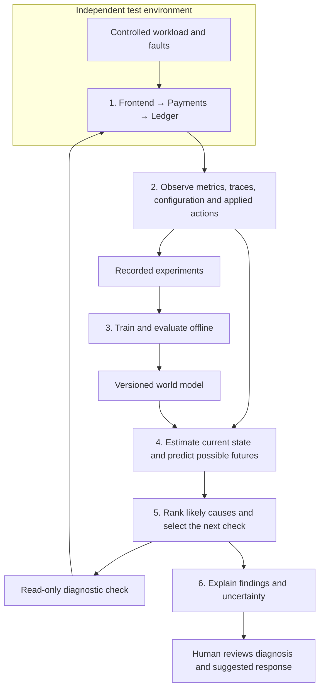

# Systems World Model: MVP plan

**Status:** exploratory plan. No model trained or cluster deployment performed.

Build a small, independent system that learns how services behave over time,
then uses that understanding to diagnose faults and choose what to inspect next.
The question is whether this improves triage over rules and an LLM alone.

## Architecture

The diagram separates **learning from recorded experiments** from **using the
trained model during an incident**. New observations update the model's estimate
of the current situation; they do not retrain its weights on every request.

## Walk through an incident

### 1. Create a small system that can break in known ways

Run our own frontend, payments service, ledger service, and disposable database.
Generate traffic and introduce controlled faults such as a small connection pool,
slow queries, CPU contention, or dependency delays. Include healthy traffic
spikes so the model cannot simply equate high load with a fault.

For example, reduce the ledger connection pool until checkout requests begin
timing out. The experiment controller knows the injected fault; the triage
system must infer it from observations without seeing that answer.

### 2. Observe what happened over time

Collect the service relationships, configuration, traffic, latency, errors,
resource usage, and selected traces. Record when a change actually took effect
and what happened afterward. Keep missing or stale measurements explicit.

These are the model's inputs. A compact learned representation summarizes them,
but that representation alone is not the world model: the model must also learn
how the system changes over time.

### 3. Learn system behavior from experiments

Train a small predictive model on sequences of observations, applied changes,
and subsequent outcomes. Start with a fast simulator, then test and refine the
approach using real lab services. Success in simulation alone is insufficient.

The model learns patterns such as how limited ledger capacity affects payment
latency as traffic increases. A diagnostic component learns to associate those
patterns with known fault types. Keep unseen experiments separate for evaluation.

### 4. Estimate the current situation and predict what comes next

During triage, the model reads recent observations and maintains an estimate of
the system's state, including uncertainty. It predicts how symptoms may evolve
under the current workload and, where training evidence supports it, under a
candidate change.

In our example, it might predict growing payment queues while ledger capacity
remains constrained. Predictions are estimates to test, not proof of a cause or
a guarantee that a proposed fix will work.

### 5. Compare explanations and choose the next diagnostic check

Rank a small set of known explanations, with an unknown option. For checkout
timeouts, candidates might include pool exhaustion, slow queries, or CPU pressure.

Choose a read-only check that can distinguish them—for example, inspect pool
occupancy and database query duration. Feed the returned observations back into
step 4, then update the diagnosis. The planner uses the model's predictions of
possible check results; if those predictions are unreliable, use a fixed checklist.

This loop is the central MVP experiment: can the system reach a better diagnosis
with fewer checks? Comparing possible fixes is a secondary, advisory capability.

### 6. Explain the result to a human

Return the likely cause, supporting and conflicting evidence, uncertainty, and
recommended next step. An optional frozen LLM turns these structured results
into a clear explanation. A deterministic report works without an LLM.

The model does not approve changes or execute production remediation. Controlled
lab interventions remain separate from the read-only diagnostic loop.

## What is being built—and how Dreamer inspires it

This is **a separately trained predictive model plus a diagnostic planning
harness**. It is not LLM fine-tuning. The LLM, if used, remains unchanged.

Dreamer provides the inspiration: learn a compact representation of an environment,
predict how it evolves under actions, and use imagined futures to guide decisions.
Here the environment is a service chain rather than a game or robot.

The MVP borrows that approach but does not implement Dreamer's full actor-critic
reinforcement-learning loop. It does not require a BayesNet. Full policy learning
and support for arbitrary service topologies are possible later experiments.

## Build sequence

| Stage | Outcome |
| --- | --- |
| Establish the lab and baselines | Repeatable faults, recorded observations, and rules/LLM triage to compare against |
| Train a small world model | Predictions of system behavior on unseen experiments |
| Add diagnostic planning | Ranked causes, useful next checks, and explicit uncertainty |
| Validate on AMD | The same experiment works on real services in an isolated namespace |
| Demonstrate and decide | A small API/CLI and report show whether the approach earns further investment |

Start with the experiment and baseline, not a large model. The initial planning
estimate is roughly 2–3 engineering weeks, subject to data quality and available
lab capacity; useful model performance is not guaranteed.

## Deployment and independence

Use the proposed AMD namespace **`systems-world-model-lab`**, with its own services,
data, model artifacts, and deployment configuration. Keep the repository and
runtime independent of AutoSRE and existing BearBank demos.

Confirm AMD capacity before deployment. Bound CPU, memory, storage, and experiment
duration; restrict network access and permissions to the lab. Do not assume GPU
availability. Start with local development and CPU-compatible smoke tests.

## How we decide whether it works

Evaluate on whole experiments held out from training, including different loads
and configurations. Compare against rules, a simple diagnostic classifier, simple
forecasting, and a frozen LLM given the same evidence and check budget.

Look for better root-cause accuracy or fewer diagnostic checks at comparable
accuracy. Also measure prediction quality, confidence calibration, healthy-system
false alarms, inference time, and behavior on unfamiliar faults. Report uncertainty
in the results and whether simulator performance transfers to the real lab.

The model must not see hidden fault labels during triage or future observations
before they occur. If it cannot outperform a simpler approach, document that
result rather than expanding the architecture to conceal it.

## References

- [DreamerV3 project](https://danijar.com/project/dreamerv3/)
- [Official DreamerV3 implementation](https://github.com/danijar/dreamerv3)
- [World Models: representation, prediction, and control](https://worldmodels.github.io/)
