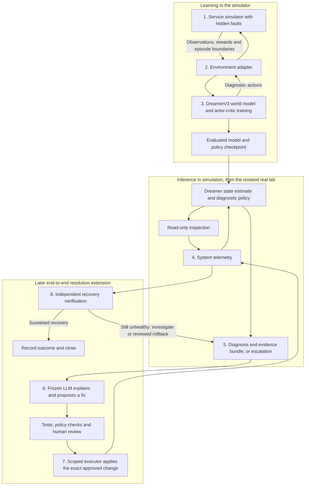

# Systems World Model: DreamerV3 triage MVP

**Status:** The frozen Dreamer-state classifier is **deployed as the isolated lab default** (model 23, `inspect-latent`, source v20). HTTP replay matched **80/80** saved diagnoses; fresh live API validation scored **80/80**, with **10/10 in every known fault family**. Seven tests, evidence verification, rollback restoration and the post-promotion healthy check passed. This is a diagnosis-only POC for eight known regimes; broader generalization, learned investigation and LLM-driven remediation remain future work. See [results](reports/LATENT_API_RESULTS.md) and [runbook](docs/LATENT_API_RUNBOOK.md).

Reuse the [DreamerV3 implementation](https://github.com/danijar/dreamerv3), train
it on a small system-triage environment, and test whether its learned behavior
improves diagnosis. Then add a frozen LLM and a controlled execution workflow to
demonstrate end-to-end resolution in an independent lab.

## What we reuse and what we build

**Reuse DreamerV3's world model, replay/training machinery, and actor-critic policy
learning from imagined trajectories.** Train weights from scratch on system
observations and diagnostic actions; do not assume game-trained weights transfer.
Pin an upstream revision and preserve its license when implementing. The linked
repository describes itself as a DreamerV3 reimplementation, not a Google/DeepMind
supported product.

Build the environment adapter, telemetry/action contract, fault scenarios,
evaluation, and later the LLM/execution integration. We are not replacing Dreamer
with a custom neural world model, adding a BayesNet, or fine-tuning an LLM.

## Architecture

Training changes model and policy weights. Inference uses a fixed checkpoint,
updating its internal state as observations arrive. Recovery evidence can become
future training data after review; it does not automatically retrain the live model.

## Walk through the smallest triage experiment

### 1. Make a small environment with ambiguous symptoms

Start with one simulated request-processing service, a queue, and a simplified
downstream dependency. Two hidden faults—CPU bottleneck and downstream slowdown—
can both raise latency and queue depth. Include healthy operation and traffic
spikes. Faults are controlled by the experiment, never chosen by the diagnostic
policy. No LLM, real microservices, or Kubernetes is required for this first test.

### 2. Give Dreamer observations and meaningful choices

Expose request rate, latency, errors, queue depth, and results of inspections.
Include time, measurement age, and missing-value indicators. Detailed CPU or
downstream measurements become visible only after the corresponding inspection.
Retain collected evidence so repeated checks are not rewarded unnecessarily.

Actions are finite: wait, inspect CPU, inspect downstream latency, submit one
of the known diagnoses, or escalate as unknown. Each action consumes time and
may carry a cost. An inspection reveals information; it does not repair the
service. The adapter maps these observations/actions and episode boundaries to
the pinned Dreamer implementation's interface.

Reward correct diagnosis, penalize wrong conclusions, and charge for checks and
delay. Bound episode length and make escalation preferable to unsupported guesses,
without making always-escalate an easy winning policy. Ground-truth faults are
used for scoring only, never included in inference observations. Test that reward
values and identifiers cannot leak the hidden answer before diagnosis.

### 3. Learn a world model and a diagnostic policy

Dreamer gathers experience, learns to predict its environment, and trains a
policy using imagined trajectories. Here a useful imagined trajectory is:
inspect CPU, observe the result, inspect downstream if necessary, then diagnose.

The trained policy selects diagnostic actions; we do not require a separate
hand-built information-gain planner. Check that it actually learns diagnostic
structure rather than exploiting simulator shortcuts. Dreamer's action scores
are not automatically calibrated probabilities of root causes.

### 4. Prove useful triage before adding integration

On unseen episodes, the agent should distinguish the two faults with fewer
checks or better accuracy than a fixed checklist. Show the observation timeline,
selected checks, final diagnosis, and actual fault in an evaluation report.

Then replace the simulator behind the same contract with isolated lab services
on AMD. Collect real trajectories and evaluate transfer; retrain or adapt on
separate training episodes if necessary. Simulator success is not evidence of
real-system effectiveness. Unfamiliar faults should trigger escalation.

## How an LLM extends this to end-to-end resolution

The LLM is a complementary reasoning and coding component, not Dreamer's trainer
or a source of ground-truth diagnoses. Keep it frozen initially.

### 5. Pass a structured evidence bundle

Give the LLM the selected diagnosis, timestamped measurements and references,
checks performed, known limitations, current configuration/code revision, and
missing information. Pass only interpretable outputs—not an unexplained latent
embedding. Only expose confidence measures if separately validated.

For example, the policy identifies downstream slowdown after observing normal
CPU and a slow dependency measurement. That identifies where to investigate;
it does not prove which line of code or setting is responsible.

### 6. Let the LLM propose a concrete repair

The LLM reads permitted lab configuration, logs, and code to narrow the mechanism,
then proposes a small change with supporting evidence, tests, expected recovery,
and a rollback plan. For the first resolution demo, use a bounded configuration
fault and one allowlisted repair. Arbitrary generated code fixes come later.

If evidence conflicts with the diagnosis, the LLM requests more investigation or
escalates. It must not convert a broad symptom classification into a certain fix.
Additional LLM tool calls are tracked and count toward evaluation cost.

### 7. Execute through explicit controls

A separate workflow validates the proposal, runs checks, obtains review for the
exact revision, and applies it through a namespace-scoped executor. For the first
lab demo this can be a reviewed configuration artifact; GitHub PR/merge and Slack
are optional later interfaces, not prerequisites for proving the approach.

The LLM and Dreamer do not hold unrestricted deployment authority. Persist action
identities and execution receipts; reconcile an uncertain write before retrying
so a crash cannot silently apply a change twice.

### 8. Verify actual recovery and close the loop

A verifier checks the applied revision, workload health, latency/error recovery
over a declared observation window, and absence of regressions under comparable
load. Neither a successful deployment nor a favorable model prediction counts
as resolution. If recovery fails, return the observed evidence for investigation
or execute a separately authorized rollback. Record failed fixes as well as
successes, and restore experiment state at the end.

**Important boundary:** the initial Dreamer policy is trained on diagnostic
checks, not deployment actions. It cannot meaningfully simulate an arbitrary
LLM-generated patch. Predicting repair outcomes requires expanding the action
space and collecting corresponding intervention trajectories in a later phase.
The first end-to-end demo verifies repairs through actual lab execution.

The concrete next-stage design is in [MICROSERVICE_MVP.md](MICROSERVICE_MVP.md).

## Build stages and success criteria

| Stage | Deliverable and decision |
| --- | --- |
| 1. Simulator and adapter | Repeatable ambiguous faults, bounded diagnostic actions, and a fixed-checklist baseline |
| 2. DreamerV3 training | Reused upstream model and actor-critic learn useful triage on unseen episodes |
| 3. Real AMD lab | Demonstrate diagnosis on held-out real experiments; measure and address transfer failures |
| 4. LLM resolution demo | One diagnosis-to-reviewed-repair-to-verified-recovery scenario, including failure and rollback paths |

Keep stage 2 usable without an LLM. Evaluate diagnosis accuracy, checks/cost,
time to diagnosis, healthy false alarms, escalation behavior, prediction quality,
compute, and variability across seeds. Split by whole experiment and hold out
workloads/configurations, not random windows from the same run.

For the extension, compare checklist + the same LLM, LLM-only investigation and
repair, and Dreamer + LLM under equal evidence/action budgets. Measure verified
resolution rate, time, unnecessary changes, failed fixes, and rollback behavior.
Choose numerical acceptance thresholds before the final held-out evaluation.
Proceed only if Dreamer improves accuracy or cost without hiding failures through
excessive escalation. If it does not, retain and report the negative result.

## Deployment and independence

Own the simulator, services, data, artifacts, and deployment in this repository;
no AutoSRE imports, databases, credentials, or existing demo dependencies.
Proposed AMD namespace: **`systems-world-model-lab`**. Use separate storage,
restricted network access, namespace-only permissions, resource limits, experiment
deadlines, and cleanup. Do not touch AutoSRE, BearBank, or staging workloads.

Check JAX/runtime compatibility and AMD capacity before choosing training hardware.
CPU smoke tests do not establish practical training throughput, and AMD GPU
support is not assumed. Local simulation comes first; real lab deployment follows
a measured capacity and compatibility check. Estimate schedule after the adapter
and first training run establish sample requirements and training speed.

## References

- [DreamerV3 project](https://danijar.com/project/dreamerv3/)
- [DreamerV3 code to reuse](https://github.com/danijar/dreamerv3)
- [World Models: representation, prediction, and control](https://worldmodels.github.io/)
