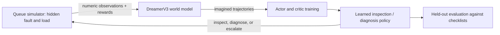

# Systems World Model

A standalone, executable DreamerV3 experiment for active systems diagnosis.
The first POC trains the project-linked DreamerV3 implementation from scratch
on a partially observed queue simulator. It runs on **AMD Halo, CPU only**, in
its own Kubernetes namespace: `systems-world-model-lab`.

## What is implemented

The encoder, RSSM, prediction heads, imagination training, actor and critic are
upstream code. The environment adapter and evaluation harness are ours. This
is model training for a new environment, not LLM fine-tuning. No BayesNet is used.

**Scope:** synthetic diagnosis only. No LLM calls, production telemetry, real
fault injection, code repairs, or real-service recovery are claimed. The later
LLM resolution architecture remains in [MVP_PLAN.md](MVP_PLAN.md).

## Experiment

Three 4,000-step pilot runs and three fresh 50,000-step main runs, with three
fault classes and seven actions. Each seed is evaluated on 150 familiar-load
and 150 shifted-load episodes per method. Fixed and adaptive checklists and a
uniform random policy use the same observation/action interface.

**Measured result (9 November 2026):** the integration runs, but the learned
policy does not yet perform useful diagnosis. Across 450 episodes per load regime:

| Method | Familiar-load accuracy | Shifted-load accuracy | Familiar-load inspections |
|---|---:|---:|---:|
| DreamerV3 | 0.2% | 0.2% | 0.00 |
| Adaptive checklist | 100.0% | 100.0% | 1.67 |
| Random | 26.9% | 24.0% | 0.48 |

Dreamer escalated 99.3% / 99.6% of familiar / shifted episodes. Training took
18.54 minutes total for the three main seeds. The 4,000-step pilot had 25.6%
familiar-load accuracy; more training converged toward abstention. This is a
negative learning result, not evidence that the method is effective in real triage.
The next controlled experiment should isolate abstention reward and inspection
exploration, with fresh evaluation seeds.

[Read the four-page research report](output/pdf/dreamerv3-system-triage-poc.pdf).
Episode-level results, configurations and logs are under `reports/evidence/`. See [the protocol](reports/PROTOCOL.md) for budgets and limits;
all seeds, including unsuccessful policies, are retained.

## Run and inspect

- [RUNBOOK.md](RUNBOOK.md): exact upstream pin, dependencies, deployment and reproduction.
- [UPSTREAM.md](UPSTREAM.md): source reuse and licensing.
- `experiment/environment.py`: bounded partially observed simulator.
- `experiment/run.py`: real upstream training and held-out evaluation.
- `experiment/diagnose.py`: load a saved checkpoint and print a simulated incident trace.
- `scripts/paper.py`: regenerate the research PDF from measured evidence.

The lab has a four-core / 6 GiB memory limit, default-deny networking after
installation, no Kubernetes API credentials, and no host mounts. Training jobs
finish automatically; checkpoints stay in the lab PVC. Namespace boundaries do
not eliminate shared-host contention. Readiness/restart evidence and existing
Argo CD instability are recorded explicitly.

This is independent of AutoSRE and is not a production remediation agent.
