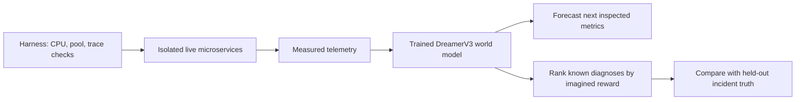
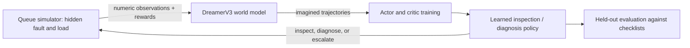

# Systems World Model

[One-page research proposal](output/pdf/systems-world-model-proposal.pdf)

A standalone DreamerV3 experiment for system triage. The current POC learns a recurrent representation from measured checkout/payment/ledger/PostgreSQL trajectories and serves a frozen diagnostic classifier over that state. It runs on **AMD Halo, CPU only**, in its own Kubernetes namespace: `systems-world-model-lab`.

## External RCAEval experiment

The isolated RE1-OB pilot completed: on 25 held-out incidents, Dreamer’s state
classifier scored **5/25**, the matched raw-telemetry classifier **24/25**, and a
BARO-style baseline **6/25**. This short Dreamer run did not improve triage.
All lab deployments are restored; the serving model is unchanged.
[Results](reports/RCAEVAL_RESULTS.md) · [Protocol](reports/RCAEVAL_PROTOCOL.md).

A validation-only follow-up improved Dreamer from **5/25 to 14/25** through
state averaging and regularization, then **16/25 and 19/25** after longer training
with two seeds. Raw telemetry remains ahead at **23/25**. The original test
results are frozen; no candidate was promoted.
[Follow-up evidence](reports/RCAEVAL_READOUT_RESULTS.md).

Adding training-only root-cause supervision reached **25/25 validation diagnoses
for both seeds**, versus raw telemetry’s **23/25**. Both models passed actual
label-isolation audits. This is development evidence. The fresh confirmation below tests it against a
supervised non-world-model control. Serving is unchanged.
[Supervision results](reports/RCAEVAL_SUPERVISION_RESULTS.md).

Fresh RE2-OB confirmation used 60 training incidents and 30 untouched test incidents.
Dreamer scored **30/30 and 27/30** across two seeds; the supervised temporal MLP
and raw-telemetry ridge each scored **30/30**. This does **not** demonstrate added
value from Dreamer on this collection. All three errors were packet-loss cases.
Test labels stayed outside the cluster; both label-isolation audits passed.
All five lab deployments are healthy, with the serving model unchanged.
[Confirmation results](reports/RCAEVAL_CONFIRMATION_RESULTS.md) · [Frozen protocol](reports/RCAEVAL_CONFIRMATION_PROTOCOL.md).

A fresh **partial-telemetry Sock Shop** experiment hid half the service groups
at each post-fault step. On 30 held-out incidents, Dreamer scored **30/30 and 28/30**;
the same recurrent architecture trained only for diagnosis scored **30/30 and 29/30**,
and raw telemetry scored **28/30**. This matched comparison did not demonstrate
added value from the world-model objectives. All four audits passed; the serving
model is unchanged and only the five service pods remain.
[Partial-telemetry results](reports/RCAEVAL_PARTIAL_RESULTS.md) · [Frozen protocol](reports/RCAEVAL_PARTIAL_PROTOCOL.md).

The next **active check-selection experiment** used 30 fresh Train Ticket incidents
and one shared diagnosis classifier. Dreamer’s mean accuracy across budgets 1–4
was **66.7% / 70.0%**, versus **70.8%** for a fixed check order. It did not reduce
the checks needed. All methods reached **28/30** with full information, below the
reliability target. Test traces are frozen; the lab is restored with five service
pods and no model promotion.
[Acquisition results](reports/RCAEVAL_ACQUISITION_RESULTS.md) · [Frozen protocol](reports/RCAEVAL_ACQUISITION_PROTOCOL.md).

A **training-only forecast audit** now identifies weak check ranking: imagined
entropy agrees with actual shared-classifier usefulness only **52.8% / 49.3%**
of candidate pairs. Decoded telemetry also has large outlier errors. Both frozen
models and the held-out results are unchanged; inference is restored. Next: audit
feature scaling and align acquisition with the actual diagnostic classifier before
another confirmation run. [Audit results](reports/RCAEVAL_FORECAST_AUDIT_RESULTS.md).

## Current deployment — validated live triage API

The frozen Dreamer-state classifier is **deployed as the isolated lab default** (model 23, `inspect-latent`, source v20). HTTP replay matched **80/80** saved diagnoses; fresh live API validation scored **80/80**, with **10/10 in every known fault family**. Seven tests, evidence verification, rollback restoration and the post-promotion healthy check passed. This is a diagnosis-only POC for eight known regimes; broader generalization, learned investigation and LLM-driven remediation remain future work.

[API and rollback runbook](docs/LATENT_API_RUNBOOK.md) · [Results](reports/LATENT_API_RESULTS.md) · [Research note](output/pdf/dreamerv3-latent-api.pdf)

## Previous experiment — independent learned-state confirmation

Independent confirmation **passed: 80/80 exact diagnoses**, including **10/10 in each of eight known fault families**, using a classifier over an independently trained Dreamer state (model seed 23, scenario seed 6801). Raw telemetry scored 78/80; imagined-reward diagnosis scored 70/80. This validates a limited known-regime POC, not production reliability or autonomous resolution. Baseline deployments are restored; the candidate is not promoted. Next: integrate the frozen classifier into the inference-only API and verify parity and fresh live behavior.

[Results](reports/LATENT_CONFIRMATION_RESULTS.md) · [Research note](output/pdf/dreamerv3-latent-confirmation.pdf)

## Previous experiment — clean measurement windows

The warm-up measurement fix passed all window checks and healthy cases scored **10/10**. On 80 fresh incidents, Dreamer’s reward readout scored **77/80** and still failed the primary gate; its frozen latent-state classifier scored **80/80** as a secondary result. Independent confirmation was skipped under the prespecified rule. Baseline deployments are restored and no candidate was promoted. Next: prespecify the latent classifier as the candidate and validate it with an independent model and fresh incidents.

[Results](reports/MEASUREMENT_WINDOW_RESULTS.md) · [Research note](output/pdf/dreamerv3-measurement-window.pdf)

## Previous experiment — complete fault-regime coverage

With all eight regimes represented in training, development Dreamer scored **77/80** fresh exact diagnoses versus **78/80** for telemetry. The primary gate **failed**. Independent confirmation was skipped as prespecified. The existing deployment is restored. This tests known regimes, not unseen combinations. Next: fix the warm-up measurement window, then run fresh validation before independent confirmation.

[Results](reports/COMPLETE_COVERAGE_RESULTS.md) · [Research note](output/pdf/dreamerv3-complete-coverage.pdf)

## Earlier experiment — auxiliary mechanism supervision

With auxiliary supervision, Dreamer’s reward readout scored **77/80**, its auxiliary head **71/80**, and telemetry alone **77/80**. All three achieved **70/70** on healthy, single and pair families, but failed unseen-triple acceptance. Labels are training targets only. The existing deployment is restored and no candidate was promoted. Independent confirmation and a matched ablation remain necessary; LLM integration and autonomous resolution are future work.

[Results](reports/AUXILIARY_SUPERVISION_RESULTS.md) · [Research note](output/pdf/dreamerv3-auxiliary-supervision.pdf)

## Earlier experiment — regularized heads rejected before fresh testing

Training-only selection produced **120/140** stratified predictions but **0/60**
withheld-pair predictions for the selected latent head. A telemetry skip-connection
search chose **zero latent weight**: the raw comparator remained stronger. No
fresh test batch or cluster change was needed; no fresh seed was used in that earlier study.

The next hypothesis is independent mechanism supervision during world-model
training. This was subsequently implemented in the auxiliary experiment above. Reliable combined-fault triage
remains unfinished; the deployed controller is unchanged.

[Selection results](reports/REGULARIZED_HEAD_RESULTS.md) ·
[Research note](output/pdf/dreamerv3-regularized-head.pdf)

## Earlier experiment — fault signals are partly recoverable from frozen state

On 80 fresh incidents, the existing Dreamer reward path scored **50/80**, a
linear probe of its frozen latent state **63/80**, raw-telemetry probes **76/80**,
and a shuffled-label latent control **15/80**. No Dreamer weights changed.
The latent probe recovered 20/30 CPU combinations but introduced other errors;
none passed every acceptance gate. Even shuffled labels fitted perfectly on
training data, exposing the probe's capacity to overfit.

Next: select a regularized multi-label diagnostic head with training-only
cross-validation before another fresh evaluation. The previous controller is
restored. This remains experimental triage, not reliable autonomous resolution.

[Probe results](reports/LATENT_PROBE_RESULTS.md) ·
[Research note](output/pdf/dreamerv3-latent-probes.pdf)

## Earlier experiment — combined diagnoses still fail with CPU contention

A fresh DreamerV3 model with eight fault-set answers scored **49/80 (61.25%)**
exact diagnoses. A small learned baseline scored **76/80 (95%)** on the same
observations. Dreamer correctly handled all ten pool-plus-delay incidents but
missed every CPU-containing combination. Neither model passed every family gate.

The earlier controller is restored. The next experiment will probe whether
Dreamer's recurrent state loses mechanism information or its reward readout
fails to use it, before another full retraining. This is still an experimental
triage system, not reliable autonomous resolution.

[Results and next step](reports/MECHANISMS_RESULTS.md) ·
[Research note](output/pdf/dreamerv3-compositional-diagnosis.pdf)

## Earlier follow-up — predictive guard helps, reliability gates still fail

On 10 November, a forecast-error escalation guard was tested on **96 fresh
physical incidents** using the existing three models. It escalated every
CPU+delay and CPU+pool case. Pool+delay escalation was 100%, 83.3%, 83.3% by seed.
There were **zero false escalations** on 60 known-case incidents per model.
However, known ledger-delay diagnosis was only 86.7%, 93.3%, 86.7%, below the
90% per-class target for two seeds. The guard did not cause or catch those errors.
The previous confirmation therefore remains a historical result, not evidence
that every fresh incident stream meets the reliability target.

The new guard **was not promoted**: the lab is restored to `inspect-first` and
the candidate remains available as `inspect-guarded` for research. Next work
must improve delay-versus-pool separation and representation of simultaneous
mechanisms; tightening thresholds against this same pilot would not be valid
confirmation. No model weights were changed in this follow-up.

[Follow-up results](reports/UNKNOWN_FAULT_RESULTS.md) ·
[Two-page research note](output/pdf/dreamerv3-predictive-escalation.pdf)

## Live microservice MVP — known-case confirmation passed

A separate live lab now runs checkout -> payment -> ledger -> PostgreSQL,
with real HTTP/SQL traffic and bounded CPU, connection-pool and delay faults.
All resources stay in `systems-world-model-lab`; no AutoSRE or BearBank services
are used. This repository owns the code, manifests, models and evidence.

| Live development condition | Accuracy | Inspections | Forecast MSE vs baseline |
|---|---:|---:|---:|
| Original features, native actor | 25% (24 cases) | 0 | No forecasts |
| Physical scaling, native actor | 75% (24 cases) | 0.33 | 0.0570 vs 0.0483 |
| Scaled model, inspect-first harness | 100% (24 cases) | 3 | 0.0439 vs 0.0790 |
| Same harness, increased load/severity | 100% (24 cases) | 3 | 0.1963 vs 0.2780 |

The evidence-first harness fixes CPU, pool and trace inspections, then uses the
world model's imagined diagnostic rewards to choose a cause. **The diagnosis is
learned; inspection order is fixed.** This is a harness change around trained
DreamerV3, not an LLM fine-tune or a claim of learned active sensing. The checklist
also achieved 100%, with fewer checks. Eight combined CPU-plus-delay incidents
exposed incomplete diagnoses: both methods identified CPU but missed delay.
Unknown-fault detection and autonomous repair remain unsupported.

Fresh seeds 10/11/12 passed the frozen confirmation gates on 120 held-out live
incidents (360 model-incident evaluations), with increased load and severity:

| Seed | Exact diagnosis | Median seconds | Forecast MSE / baseline |
|---|---:|---:|---:|
| 10 | 119/120 (99.2%) | 1.64 | 0.1981 / 0.2846 |
| 11 | 120/120 (100%) | 2.39 | 0.2123 / 0.2853 |
| 12 | 119/120 (99.2%) | 2.44 | 0.2015 / 0.2874 |

Every model used three fixed inspections and had zero healthy false alarms.
Seeds 10/12 confused one ledger-delay incident with pool contention. The checklist
scored 119/120, using 2.25 checks on average. These small paired samples do not
establish statistical superiority or production reliability. Combined-fault
recognition remains unsupported. Training took 25m49s wall time; the live batch
20m23s. The five lab deployments are running with frozen checkpoints; fault and
load jobs have finished. A separate healthy investigation passed in 0.30 seconds.

Read the [measured results](reports/MICROSERVICE_RESULTS.md),
[confirmation evidence](reports/evidence/microservice/confirmation-summary.json), and
[live research note](output/pdf/dreamerv3-live-microservice-study.pdf),
[prospective protocol](reports/MICROSERVICE_PROTOCOL.md) and
[operating guide](microservice/README.md).

## Confirmed synthetic POC result

**Passed the frozen confirmation gate on 9 November 2026.** Three freshly trained
models (seeds 10, 11, 12) each achieved **100% accuracy at both familiar and shifted
load**, with **one inspection per incident and zero unresolved cases**. That is
900 held-out incidents in total. All three saved-model demonstration cases also
passed. The three training/evaluation jobs completed in 26.7 minutes elapsed.

| Confirmation method | Familiar accuracy | Shifted accuracy | Inspections (familiar) |
|---|---:|---:|---:|
| Native sampled Dreamer actor | 90.0% | 93.8% | 0.99 |
| Native actor with 16-particle voting | 100.0% | 100.0% | 1.00 |
| Adaptive checklist | 100.0% | 100.0% | 1.67 |
| Fixed checklist | 100.0% | 100.0% | 2.00 |

The confirmed configuration trains from scratch for 100,000 steps, uses a higher
training abstention cost and training-only inspection coverage, and votes across
16 native latent-state/actor samples during inference. No expert diagnosis rules
or hidden fault labels are supplied at inference. Voting changes inference, not
model weights. This small synthetic result does **not** establish real-system
transfer, superiority to optimal expert rules, or LLM-assisted repair.

[Read the five-page follow-up research report](output/pdf/dreamerv3-triage-followup.pdf).
The [confirmation gate](reports/evidence/followup/confirmation-particle-gate.json),
[three-incident trace](reports/evidence/followup/confirmation/demo.json), failed
trials, and every seed's episode-level evidence are preserved. Runtime tests:
**10 passed**. Experiment processes and the temporary collector have stopped;
checkpoints remain in the isolated lab PVC.

## What is implemented

The encoder, RSSM, prediction heads, imagination training, actor and critic are
upstream code. The environment adapter and evaluation harness are ours. This
is model training for a new environment, not LLM fine-tuning. No BayesNet is used.

**Historical queue-POC scope:** synthetic diagnosis only. The live extension
above adds isolated fault injection, but no LLM calls, production telemetry,
code repairs or real-service recovery. The later
LLM resolution architecture remains in [MVP_PLAN.md](MVP_PLAN.md).

## Original baseline experiment

Three 4,000-step pilot runs and three fresh 50,000-step main runs, with three
fault classes and seven actions. Each seed is evaluated on 150 familiar-load
and 150 shifted-load episodes per method. Fixed and adaptive checklists and a
uniform random policy use the same observation/action interface.

**Original baseline (9 November 2026):** the integration ran, but this initial learned
policy did not perform useful diagnosis. Across 450 episodes per load regime:

| Method | Familiar-load accuracy | Shifted-load accuracy | Familiar-load inspections |
|---|---:|---:|---:|
| DreamerV3 | 0.2% | 0.2% | 0.00 |
| Adaptive checklist | 100.0% | 100.0% | 1.67 |
| Random | 26.9% | 24.0% | 0.48 |

Dreamer escalated 99.3% / 99.6% of familiar / shifted episodes. Training took
18.54 minutes total for the three main seeds. The 4,000-step pilot had 25.6%
familiar-load accuracy; more training converged toward abstention. This is a
negative learning result, not evidence that the method is effective in real triage.
The follow-up below tests abstention reward and inspection exploration, retaining
this baseline as historical evidence.

[Read the four-page research report](output/pdf/dreamerv3-system-triage-poc.pdf).
Episode-level results, configurations and logs are under `reports/evidence/`. See [the protocol](reports/PROTOCOL.md) for budgets and limits;
all seeds, including unsuccessful policies, are retained.

## Follow-up experiments

These are development results (one seed, 150 episodes per load regime), not the
three-seed confirmation required by the [follow-up protocol](reports/FOLLOWUP_PROTOCOL.md).

| Training change | Familiar accuracy | Shifted accuracy | Observed behavior |
|---|---:|---:|---|
| Escalation penalty only | 32.0% | 34.0% | Guessing without inspections |
| Inspection coverage only | 0.0% | 0.0% | Escalates despite diagnostic experience |
| Combined correction, native actor | 93.3% | 94.7% | About one inspection |
| Combined correction, 16-particle native actor vote | 100.0% | 100.0% | One inspection |

A separate 90-episode probe **forced both inspections**. The learned world model
ranked the correct diagnosis first in 76.7% of cases, but the actor made no correct
diagnoses. Predicted rewards were still too pessimistic: this probe is not evidence
of autonomous triage. After the combined correction and 100,000 training steps,
the same probe reached 100% world-model ranking accuracy (reward RMSE 0.103).

The particle controller keeps 16 latent-state/actor samples of **one model**,
executes their majority action once, and feeds that action back to every sample.
It adds no diagnosis rules or extra sensor observations. The subsequent frozen
confirmation used seeds 10, 11, 12 and untouched evaluation streams; all three
passed, as reported above. No tuning was performed against confirmation results.

## Run and inspect

- [RUNBOOK.md](RUNBOOK.md): exact upstream pin, dependencies, deployment and reproduction.
- [UPSTREAM.md](UPSTREAM.md): source reuse and licensing.
- `experiment/environment.py`: bounded partially observed simulator.
- `experiment/run.py`: real upstream training and held-out evaluation.
- `experiment/diagnose.py`: load a saved checkpoint and print a simulated incident trace.
- `scripts/followup_paper.py`: regenerate the current research PDF from measured evidence.
- `scripts/proposal.py`: regenerate the one-page proposal.
- `scripts/paper.py`: regenerate the historical baseline report.

The lab has a four-core / 6 GiB memory limit, default-deny networking after
installation, no Kubernetes API credentials, and no host mounts. Training jobs
finish automatically; checkpoints stay in the lab PVC. Namespace boundaries do
not eliminate shared-host contention. Readiness/restart evidence and existing
Argo CD instability are recorded explicitly.

This is independent of AutoSRE and is not a production remediation agent.
