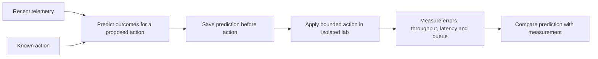
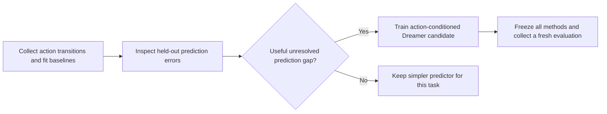
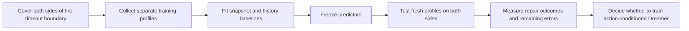
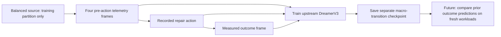
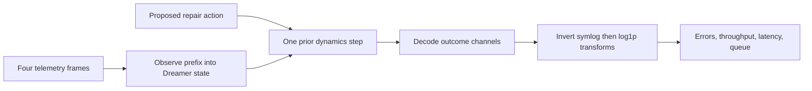
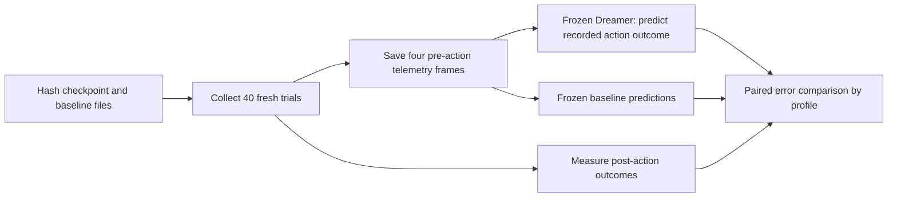

# Predict the effect of a repair

## Question

Given recent telemetry and a proposed action, can a model predict what happens next?
The previous snapshot screen was already strong at naming faults. This experiment
moves to outcomes, where an action can reduce latency while leaving every request
failed, or clear a queue by sacrificing most throughput.

## First step: establish simple action-aware baselines

Use four actions: do nothing, remove injected database degradation, reduce offered
load to 2 requests/s, or disable retries. Database repair does not add capacity to an
already healthy database. Measure error fraction, successful requests/s, mean window
p95 latency, and mean queue depth separately; do not hide load shedding behind a
single recovery score.

Collect 36 trials from nine workload profiles. Each profile is independently recreated
under all four actions, in shuffled order. The first six profiles (24 trials) are
training; the remaining three (12 trials) are testing. All action variants of a profile
stay in the same split. These are recreated trials, not identical counterfactual worlds.
Only three independent test profiles means this is feasibility work, not confirmation.

| Measurement | Protocol |
|---|---|
| Conditions | Healthy, database degradation, upstream overload |
| Variation | Base load 18–34/s; burst 65–115/s; healthy DB hold 30–50 ms; degraded hold 80–120 ms |
| Fault onset | Randomized between seconds 2 and 3 |
| Action | Second 6, after saving the prediction |
| Outcome | Final windows from seconds 12–16 |
| Input | Last window or last four pre-action windows, plus proposed action |
| Excluded | Fault label, injected settings, profile ID, event timestamps, post-action telemetry |
| Safety | Eight client requests; 16 active requests/service; leased controls; drain before reset |

Compare action-specific averages, ridge regression using the current window, and ridge
regression using four ordered windows. All regressions include action interactions.
Select regularization from 1, 10, 100 with leave-profile-out cross-validation on training
data. Select the reference method by training CV error-fraction MAE; freeze all models
before any test trial. Report all methods and all four outcome errors. No test-driven
retuning, and no action-selection reliability claim from this small sample.

## Where DreamerV3 fits next

DreamerV3 learns a latent model of transitions from observations and actions. A future
candidate would learn from these action-labelled telemetry sequences and roll forward
under each proposed intervention. This requires a new observation/action adapter and
training on the new data; the existing steady-fault checkpoint is not a validated
predictor for this task.

First verify collection, prediction timing and baseline performance. Then determine
whether there is a measured gap worth testing with Dreamer. If proceeding, train the
candidate only on training profiles and compare it with strong current-window and
history baselines on a new, jointly frozen evaluation. The present test may inform
research design, but must not later be described as untouched confirmation for a
candidate developed after seeing it.

All execution stays in `systems-world-model-lab`. Full telemetry and model artifacts
remain on its results volume. The UI displays aggregate baseline errors and cleanup
status; no new Dreamer result is claimed by this first step.

## Interrupted-run recovery

The initial run stopped after 35 trials because the final trial failed the sampling
interval check before its prediction/action. All completed trial cleanup passed, and
the controller restored the lab. Recovery preserves the original failed run, copies
its completed trials and frozen models, verifies saved test predictions against those
models, and retries only the missing trial using the same scheduled profile/action.
It does not relax sampling checks or retune predictors. The replacement trial is a
new physical realization and is disclosed as such in the final result.

## First screening result — 24 November 2026

Run `cf9ad6cbed1c` completed the dataset from source run `3269c31c2b54`
using recovery code `16d9b47`. The original 35 trials, 11 saved test predictions,
and frozen model file were verified byte-identical (47 files). Only the final
trial was recreated; all 12 test predictions were saved before their interventions.
All 36 trial cleanup checks passed.

The history predictor was selected using training CV before testing. Held-out
mean absolute errors across 12 trials from three independent profiles were:

| Predictor | Error fraction (percentage points) | Successful requests/s | Latency (ms) | Queue depth |
|---|---:|---:|---:|---:|
| Action-specific average | 48.32 | 7.47 | 52.67 | 5.43 |
| Current-window ridge | 10.43 | 4.56 | 28.85 | 1.00 |
| Four-window history ridge | **5.33** | **3.99** | **21.90** | **0.55** |

History reduced error-fraction MAE by about 49% relative to the current-window
baseline in this screen, and had lower errors on all four measured outcomes.
This supports testing temporal information for intervention prediction. It does
not establish a Dreamer advantage: no Dreamer model was trained or evaluated here.
Three independent test profiles are too few to establish reliable generalization.

Next, repeat the frozen-baseline comparison on more independently sampled profiles
without retuning on these results. If the temporal benefit persists, collect a
larger training-only transition dataset for an action-conditioned Dreamer candidate;
compare it against the history baseline on a fresh, jointly frozen evaluation.
The current screen remains exploratory and must not become that final test set.

## Next validation: frozen models, new workloads

**Goal:** establish whether recent history improves repair-outcome prediction on
new workloads before training an action-conditioned DreamerV3 candidate.

The next batch uses nine new independent profiles (three per condition), each
recreated under all four actions: 36 trials. It copies the exact frozen predictors
from `cf9ad6cbed1c`, uses a fresh random seed, retains the original workload ranges,
and performs no training or tuning. Predictions are saved before each action;
telemetry timing and cleanup checks remain unchanged. Source artifacts are retained.

The primary comparison remains mean absolute error in post-action error fraction:
history versus current-window ridge. Report all four outcome errors and profile-level
paired differences for the complete batch, including failures; do not stop early for
a favorable score. Lower error on the primary measure is the immediate success
criterion, with per-profile consistency and the other outcomes qualifying the result.
This is validation within the existing workload ranges, not new-fault generalization.

If the benefit persists, the next milestone is an action-conditioned DreamerV3 model
trained on a separate, larger transition dataset, evaluated against the frozen
history baseline on fresh workloads. The ultimate goal is better diagnosis and
repair recommendations; this experiment measures a prerequisite—predicting repair
outcomes—and does not yet establish reliable root-cause diagnosis or action choice.

## Fresh validation and diagnosis — 24 November 2026

Run `15999a239bf1` completed all 36 trials across nine new profiles. All cleanup
checks passed and the controller restored the lab. The predictors were verified
byte-identical to the source screening run; no training or retuning occurred.

| Held-out MAE | Current window | Four-window history |
|---|---:|---:|
| Error fraction (percentage points) | **17.00** | 17.78 |
| Successful requests/s | 3.80 | **3.41** |
| Latency (ms) | **27.83** | 33.25 |
| Queue depth | **1.41** | 1.64 |

The earlier primary-metric gain did not replicate. History won on five of nine
profiles, but its mean paired error was 0.78 percentage points worse. An exploratory
paired profile bootstrap (20,000 resamples, seed 20261124) gave a 95% percentile
interval of -1.69 to +3.18 points for history minus snapshot. Nine profiles are too
few for a strong inference; this does not establish superiority or equivalence.

### Where it helped and hurt

| Condition (12 trials each) | Current-window error MAE (pp) | History error MAE (pp) |
|---|---:|---:|
| Healthy | 2.27 | **1.80** |
| Database degradation | **44.16** | 44.31 |
| Upstream overload | **4.57** | 7.24 |

Across conditions, disabling retries favored history (7.41 vs 13.38 pp), while
removing database degradation favored the current window (20.67 vs 30.14 pp).
These post-hoc subgroups are diagnostic, not separate confirmed wins. Both methods
were poor on database degradation followed by load reduction: 73.66/74.67 pp error.

### A concrete training coverage gap

The request attempt timeout is fixed at **100 ms**. Although training and validation
sampled the same configured 80–120 ms database-delay range, their few realized
profiles landed on opposite sides of that boundary:

| Database profiles | Training | Fresh validation |
|---|---:|---:|
| Independent profiles | 2 | 3 |
| Injected delay range | 105.93–109.40 ms | 83.22–93.07 ms |
| Profiles below 100 ms | 0 | 3 |
| Observed errors after reducing load | 100% in both | 0% in all three |

At low load, a delay longer than the attempt timeout can still fail every request;
a shorter delay can complete once queueing is relieved. This is a plausible
mechanistic explanation for the load-reduction prediction failure, supported by the
observed coverage and outcomes. It is not a controlled causal test, and it does not
fully explain the variable database-repair outcomes (some still had 100% errors).
Injected settings were used only for this diagnostic audit, never as predictor inputs.

### Decision and next experiment

Keep the current-window predictor as the simpler reference; retain history as a
challenger. Do not claim a Dreamer benefit or scale up Dreamer training on this evidence.
The immediate issue to address is sparse coverage of different system behaviors.

For the next collection, stratify database delays below, near, and above 100 ms;
cover offered loads below and above pool capacity, with all four actions for each
profile. Use distinct profiles in training and testing, balancing these regimes in
both. Include repeated trials of a few fixed profiles to measure outcome variability
and investigate the database-repair failures. Keep these diagnostic repeats separate
from the held-out score. Preserve input exclusions, pre-action prediction timing,
resource limits, and cleanup checks. Do not add fault settings as model features.

Choose the exact sample budget and freeze the protocol before collection. Fit and
select models only with grouped training folds. Report overall and regime-specific
error-fraction MAE, throughput, latency, queue errors, and profile-level paired
comparisons on fresh data. The completed screening and validation batches now inform
experiment design and must not serve as untouched tests for new candidates.

This analysis did not start another training run or change runtime services.

## Balanced coverage protocol

This experiment tests the coverage explanation above. It trains simple baselines;
it does not train DreamerV3. The fixed budget is **120 trials**:

| Partition | Independent profiles | Trials | Use |
|---|---:|---:|---|
| Training | 16 | 64 | Fit and select baselines with whole-profile CV |
| Fresh test | 10 | 40 | Compare frozen methods once |
| Diagnostic repeats | 2 previously trained profiles, each repeated twice | 16 | Measure variability, excluded from fitting and test scores |

Database profiles cross three delay bands (80–90, 97–103, and 110–120 ms) with two
offered-load regimes: 35–55% or 130–160% of nominal two-slot capacity (`2 / delay`).
There are two independent training profiles and one test profile per combination.
Healthy and upstream-overload controls each contribute two profiles per split.
All profiles run under all four actions, shuffled within each partition. Training
and testing use distinct random draws. Diagnostic repeats use fixed below/above
boundary, high-load training profiles and run after testing. Controls, telemetry
input exclusions, prediction timing, and cleanup rules remain unchanged.

Nominal capacity is a scheduling reference, not measured effective capacity: retries,
timeouts, and the eight-client admission limit can alter realized traffic. The new
load distribution differs from the earlier screening, so absolute scores are not a
like-for-like comparison with its 17.00/17.78 pp errors.

Primary comparison: history versus current-window error-fraction MAE on all 40 fresh
test trials. Report all outcomes, per-regime results, and paired profile differences.
Each database test regime has only one independent profile; those subgroups are
exploratory. Diagnostic repeat differences reveal variability but do not estimate a
precise noise floor from two repeats. Preserve and disclose any invalid trials;
do not drop hard cases or relax telemetry validation to finish the batch.

The runner has a two-hour deadline for this larger batch; CPU, memory, concurrency,
and namespace permissions are unchanged. Minimum observation time alone is 32 minutes,
with startup, draining, and restoration adding overhead. Results appear in the
existing experiment UI with diagnostic repeats explicitly excluded from the test count.

A useful result is improved coverage of both successful and failed intervention
outcomes and a stable comparison on fresh profiles. Persistent repair errors or large
repeat differences require investigating the measurements and recovery dynamics before
scaling model capacity. Any later Dreamer candidate needs separate training and a new,
jointly frozen evaluation against these simple baselines.

## Balanced batch result — reviewed 25 November 2026

Run `a7ca3846c2c7`, code `0af542f`, completed all **120 trials**: 64 training,
40 held-out tests across 10 independent profiles, and 16 separate diagnostic repeats.
Every trial cleanup passed and the controller restored the lab. No Dreamer model
was trained. Training CV selected the history predictor before testing.

| Held-out MAE | Current window | Four-window history |
|---|---:|---:|
| Error fraction (percentage points) | 15.72 | **12.64** |
| Successful requests/s | 3.17 | **3.02** |
| Latency (ms) | **26.41** | 28.31 |
| Queue depth | 1.42 | **1.28** |

History reduced error-fraction MAE by **19.6%** within this batch: a 3.08 percentage
point improvement. It won on 8/10 profiles, tied on one, and lost on one. An
exploratory paired profile bootstrap (20,000 resamples, seed 20261125) gave a 95%
percentile interval of -5.52 to -0.82 points for history minus snapshot. This is a
small, deliberately stratified sample, not proof of broad generalization. Better
scores than the earlier batch cannot be attributed solely to training coverage:
the training size and evaluation load distribution also changed.

### Remaining weaknesses

| Database test regime | Current-window error MAE (pp) | History error MAE (pp) |
|---|---:|---:|
| Below timeout, low load | 0.60 | **0.00** |
| Below timeout, high load | 31.49 | **28.29** |
| Near timeout, low load | 54.87 | **46.07** |
| Near timeout, high load | **5.44** | 8.04 |
| Above timeout, low load | 0.00 | 0.00 |
| Above timeout, high load | 28.28 | **28.14** |

Each database row contains one independent test profile under four actions. The
near-timeout/low-load profile remains difficult despite balanced coverage. History
also helped upstream overload (7.33 vs 15.63 pp over two profiles), so its gain is
not restricted to database faults.

For the eight fixed profile/action repeat pairs, six had identical error fractions;
the other two differed by 1.94 and 0.94 percentage points. Queue depth differed by
as much as 2.59. These repeats used only below/above-timeout, high-load profiles:
they do not explain or bound variability near the timeout boundary. Similar repeat
outcomes also do not establish that a repair succeeded; this measures consistency.

### Research decision

There is now enough evidence to justify preparing an **action-conditioned DreamerV3
candidate**, with history ridge as the stronger reference. There is still no measured
Dreamer advantage, reliable repair policy, or demonstrated improvement in root-cause
diagnosis from this experiment.

The next model experiment should encode telemetry windows and actual intervention
transitions as sequences, train Dreamer's dynamics on a separate training-only
collection, and predict the same four post-action outcomes. The existing diagnosis
checkpoint cannot simply be relabelled as a repair-outcome model. Fit any new baseline
and tune model settings only on grouped training/development profiles. Freeze all
methods before collecting a fresh, balanced comparison. Include near-boundary
repeatability checks separately, since that regime was absent from these repeats.
Do not reuse the now-inspected test cases as untouched confirmation.

This results review changes documentation only; no additional collection, training,
or runtime changes were made.

## First action-conditioned Dreamer implementation

Use the pinned upstream DreamerV3 encoder, RSSM dynamics, decoder and training loop
with a new **repair-macro-v1** adapter. This trains fresh weights; the probe-diagnosis
checkpoint has incompatible observations/actions and is not reused.

The initial smoke uses the existing **64 training trials**, excluding all 40 test
trials and 16 diagnostic repeats. It is not a new, larger training collection and
is not sufficient to claim model quality. Export records the source identity and
training file hash; it excludes fault labels, injected settings, and test examples.

An episode has four telemetry frames (51 measured features) followed by one outcome
frame (error fraction, successful requests/s, latency, queue). Features use log1p;
separate validity flags identify telemetry and outcome frames. Pre-action frames
contain no outcome values. Three transitions use no intervention; the fourth uses
the recorded action. The last transition spans the intervention-to-outcome period,
rather than a single telemetry sampling interval. This is deliberately a coarse
transition model, not a simulation of every intermediate system state.

Replay follows only the recorded actions and rejects alternatives. A scheduling
field reaches the replay controller but is excluded from agent observation spaces
and policy inputs; the model receives the action through its normal action channel.
Rewards are zero and actor outputs are overridden. No learned repair-policy claim
is made. The old auxiliary fault-classification head is not used.

The first run is fixed at **1,000 environment steps**, with the existing small
Dreamer configuration, a two-hour deadline and unchanged resource limits. The UI
will identify this as training smoke, not a held-out accuracy result. Success means
training completes and a separately identified checkpoint is saved. Runtime/JAX
integration still needs verification in the lab; unit tests alone do not establish it.

After smoke success, implement and verify checkpoint reload and prior-only outcome
forecasting: observe the four prefix frames, apply the proposed action, then decode
without assimilating the measured outcome. Invert both Dreamer's decoder transform
and the adapter's log1p transform. Validate shape, timing, and leakage controls before
any score. Subsequent training-budget selection uses training/development profiles
only, followed by a fresh jointly frozen comparison with snapshot/history baselines.

### First training smoke: replay-schema failure

Run `f9fa5102cb7c` (code `88c61e1`) successfully exported 64 training trials from
16 profiles and excluded 56 test/diagnostic trials. The training loop started but
failed at the first learner update: upstream Dreamer requires exact input keys,
and the replay batch still included `scheduled_action`. This field was already
excluded from encoder/policy inputs, but also needed removal at the learner-stream
boundary. No completed trained checkpoint or accuracy result was produced.

The local fix filters only this collector metadata before upstream stream processing
for both learning and reports, preserving the actual action channel and all measured
observations. A regression test checks the exact retained keys and confirms that the
original collector batch remains intact. Runtime verification requires a fresh smoke
run; the failed run and its artifacts are retained for provenance.

### Training smoke retry succeeded — 25 November 2026

Run `45ae19ddd400` with code `99495ed` completed all **1,000 environment steps**
and the controller restored the lab. Training consumed only the 64 training trials
from 16 balanced profiles; all 56 test/diagnostic trials were excluded. The exported
training file hash was verified against its manifest.

The final checkpoint is stored inside the results volume at
`/results/experiments/runs/45ae19ddd400/temporal-pilot/final` (three files,
8,018,807 bytes). Read-only inspection confirmed that the optimizer counter advanced
from **0 to 108** and all 261 saved parameter/state arrays were finite. The training
process took 22.66 seconds; this excludes image build, deployment, image-pull retries,
and controller restoration. The image download initially backed off before succeeding.

The run was shorter than the periodic training-metric logging interval; the JSONL
log contains episode metrics, not a loss curve. Therefore no convergence claim is
made. This validates actual learning updates and checkpoint creation, not held-out
accuracy, counterfactual repair reliability, or improvement over the simple baselines.

Next: load the checkpoint into the matching upstream agent and verify prior-only
macro-outcome inference. Observe only the four prefix frames, apply a proposed action,
and decode without supplying the measured outcome. Check numerical transforms and
input exclusions before collecting a fresh evaluation. Preserve this smoke model
and the original failed run; do not reuse previously inspected test results as an
untouched test for the new candidate.

## Prior-only inference smoke (passed — 25 November 2026)

Source checkpoint: `45ae19ddd400`. Load its saved configuration and matching
`repair-macro-v1` agent, then restore the final checkpoint. Verify the training-data
hash and feature/action schema before inference. The source checkpoint is retained
and hashed before and after the smoke.

Use the first training row for each recorded action, in saved file order: four
prefixes, each queried with all four proposed actions (16 forecasts). Do not read
measured outcomes into the predictor or score these examples. Keep the particle
budget at 16 and random seed at 777; average decoded physical outcomes across
particles, then apply the same physical bounds as the baselines (nonnegative values,
error fraction at most one). Reject nonfinite particle outputs before clipping.

Check repeatability by recomputing each selected row's recorded action. Require
finite outputs, unchanged checkpoint bytes, and an unchanged training-file identity.
The inference code observes only the prefix: no outcome frame enters the encoder
before predicting. It uses the normal Dreamer action channel after the prefix.

Success establishes checkpoint reload and functioning prior-only inference, not
prediction quality or causal validity of the alternative-action forecasts. This run
is training-data-only, performs no fitting, and injects no new service faults. Its
results are displayed as inference smoke in the UI. A fresh, jointly frozen outcome
comparison remains necessary before any accuracy or improvement claim.

Run `54d1ed6db8d8` (`396b9b7`) passed all checks: four training prefixes × four
actions produced 16 finite forecasts; repeated predictions matched within the
prespecified tolerance; checkpoint and training-file hashes stayed unchanged.
There were no runtime tracebacks. No measured outcome was supplied to inference,
and no accuracy was scored. The fresh outcome comparison is the next experiment.

## Fresh frozen comparison protocol

Freeze checkpoint `45ae19ddd400` and the existing baselines from `a7ca3846c2c7`.
Collect 40 fresh trials across 10 profiles using a new queue-generated seed: six
database delay/load regimes, two healthy profiles, and two upstream profiles, each
with all four actions. Reject profiles overlapping the source collection. No fitting
or model selection uses this batch. Keep 16 inference particles and seed 777.

Dreamer runs offline after collection, using only saved prefixes and the recorded
action. This avoids changing intervention timing with inference latency. Baseline
predictions are saved before each intervention. Hash checks reject source changes.
The test measures prediction quality, not online serving latency or repair selection.

Primary metric: request error-fraction MAE. Compare Dreamer to the baseline selected
by the original training-only cross-validation; report all three baselines, other
outcome metrics, and regime breakdowns. Define substantial improvement beforehand
as at least **5 percentage points lower MAE** with the upper bound of a paired
profile-bootstrap 95% interval below zero (10,000 resamples, seed 777). Only 10
independent profiles are available: uncertainty is exploratory, and a positive
result needs replication. This does not establish root-cause diagnosis accuracy.

The initial 1,000-step checkpoint is evaluated unchanged. If it fails, use separate
training/development profiles to adjust training, then collect another fresh test;
do not tune against this batch and describe it as untouched.

## Fresh comparison result — 25 November 2026

Run `824bb96d2700`, code `3025cc1`, seed `1498077667`: **completed, lab restored**.
All 40 trials / 10 profiles completed without runtime exceptions. The source
checkpoint and baseline identities remained unchanged; no fitting used this batch.

| Predictor | Error-fraction MAE (percentage points) | Throughput MAE (requests/s) | Latency MAE (seconds) | Queue MAE |
|---|---:|---:|---:|---:|
| Action mean | 42.84 | 7.34 | 0.0512 | 4.60 |
| Current-window ridge | 11.53 | 2.76 | 0.0197 | 1.33 |
| History ridge (training-selected primary comparator) | 16.82 | 3.38 | 0.0253 | 1.64 |
| Dreamer | 51.64 | 6.11 | 0.2628 | 4.55 |

Dreamer minus the preselected baseline: **+34.82 pp MAE**; exploratory paired
profile-bootstrap 95% interval **+18.29 to +50.53 pp**. Dreamer won on only 1/10
profiles and failed the prespecified improvement criterion. The current-window
baseline also beat history on this batch; history's earlier advantage did not
replicate here. Do not change the primary comparator after seeing these results.

Aggregate diagnostics show broad calibration failure: mean predicted error fraction
0.101 versus observed 0.554; throughput 0.408 versus 6.164 requests/s; latency 0.383
versus 0.121 seconds; queue 0.00048 versus 4.547. Queue forecasts clipped to zero in
38/40 trials. These are post-clipping predictions, not raw decoder outputs.

### Next diagnostic, before more fresh collection

The 108 optimizer updates were a smoke budget, not a converged training run.
Undertraining is a hypothesis, not established by this test. Preserve the failed
candidate and this batch as inspected evidence. On training/development profiles:

1. Check outcome reconstruction with the outcome frame observed, versus prior-only
   prediction from the prefix and action. Record raw and transformed outputs,
   clipping rates, outcome-channel reconstruction loss, and dynamics/KL losses.
2. Use profile-disjoint development folds drawn from the original training
   partition to compare fixed training budgets; keep the same splits and seeds
   across candidates. Never use this fresh test batch to select a budget.
3. If reconstruction remains poor, inspect learning and outcome weighting before
   extending training. If reconstruction works but prior prediction fails, focus
   on latent dynamics/action learning. Recheck decoding consistency as part of
   either diagnosis; finite forecasts alone do not prove accuracy.
4. Only after development evidence supports a candidate, freeze it, retrain using
   the permitted training partition if appropriate, and collect a new fresh test.

This result does not demonstrate improved root-cause diagnosis or repair selection.

## Training-only reconstruction diagnostic

Use only the 64 saved training rows and checkpoint `45ae19ddd400`. No new faults,
weight updates, development selection, or held-out scoring. For each row, assimilate
four prefix frames and the recorded action, then compare:

- **Prior forecast:** decode the imagined next latent state, without the outcome.
- **Posterior reconstruction:** encode the measured outcome frame and decode its
  posterior state. This deliberately sees the answer and is not forecast accuracy.

Keep 16 particles and seed 777. Verify the prior agrees with the existing forecaster.
Report decoder-space MSE, physical MAE before/after clipping, clipping fraction, and
final-transition posterior-to-prior KL (with/without upstream free-nats flooring).
These are diagnostic forward values, not the historical optimizer loss curve.
Hash the checkpoint and training data before/after. Poor reconstruction indicates
that dynamics alone cannot explain the problem; good reconstruction with poor prior
prediction points toward dynamics/action learning. Neither establishes that longer
training alone will solve it. Results appear separately in the experiment UI.

### Reconstruction diagnostic result — 25 November 2026

Run `aa8fda9445c9` (`57b9e7c`) completed and restored the lab. All 64 training
trials / 16 profiles were inspected, without fitting or fault injection. The
checkpoint and training identity stayed unchanged. Diagnostic prior outputs
matched the established forecaster within the specified tolerance.

| Training diagnostic | Prior forecast | Outcome-visible reconstruction |
|---|---:|---:|
| Error-fraction MAE (pp, clipped) | 47.85 | 47.84 |
| Throughput MAE (requests/s) | 6.40 | 6.60 |
| Latency MAE (seconds) | 0.263 | 0.370 |
| Queue MAE | 3.89 | 3.89 |
| Queue forecasts requiring clipping | 87.5% | 100% |
| Error-fraction forecasts requiring clipping | 15.6% | 79.7% |

The reconstruction's unbounded mean error fraction was 5.72 despite an observed
mean of 0.546; clipping hides large physical-scale errors. Its unbounded queue
mean was -0.252 versus observed 3.885. Mean final-transition posterior-to-prior KL
was 4.542 nats (approximately unchanged by free-nats flooring). These diagnostic
forward values are not optimizer loss histories or held-out performance.

**Interpretation:** poor prediction is not solely a prior-dynamics problem: the
encoder/decoder path cannot yet reconstruct training outcomes reliably. The
matching prior paths rule out a discrepancy between these two inference entry
points, not every possible implementation or representation issue. Undertraining,
loss allocation, and physical decoding sensitivity remain hypotheses.

**Next bounded experiment:** inspect outcome-channel learning and the weighting
of valid outcome frames versus zero-filled channels. Verify decoder semantics and
log-scaled reconstruction loss, then run a fixed-budget training diagnostic with
frequent loss logging. Use profile-disjoint development folds from the original
training partition for budget selection; retain current runs unchanged. Require
reconstruction progress before spending time on another fresh test.

## Loss audit and fixed training-budget diagnostic — 26 November 2026

The saved checkpoint configuration confirms `lr=4e-5`, linear optimizer warmup
of **1,000 updates**, and training ratio 16. The smoke achieved just 108 optimizer
updates: about 10.8% through warmup, reaching roughly 4.3e-6 learning rate. This is
strong reason to test adequate optimization before changing model capacity or loss.
It does not prove that extra training will solve the observed failure.

The pinned upstream `MSE.pred()` returns the transformed prediction; its loss
applies symlog to the target. Thus the existing inverse-symlog followed by inverse
log1p is consistent with the adapter. This double exponential inverse is sensitive
to decoder errors, as the unbounded reconstruction diagnostics show.

The validity bits are ordinary vector features, not loss masks. Each five-frame
57-channel episode contains 204 measured telemetry slots, four measured outcome
slots, ten validity flags, and 67 zero padding slots. Outcome channels are trained
toward zero in four prefix frames. The four measured outcomes occupy 4/285 scalar
slots (1.4%); this is a count, NOT a measured gradient/loss contribution. Padding
and unequal channel counts are plausible concerns, not established causes.

Prepare one fixed **25,000-environment-step** run from the same 64 training trials,
seed 113, fresh initialization, and unchanged 1,000-update warmup/model/loss. Change
only training duration and log interval (5 seconds). Keep the two-hour runtime
limit and existing namespace/resource restrictions. Expected optimizer updates are
roughly 3,100 at the existing ratio; verify the actual counter and loss logs rather
than assuming this. Preserve the earlier checkpoint.

Automatically repeat the training-only prior/reconstruction diagnostic after saving
the new checkpoint. Its outputs appear in the run UI. No new service faults, no
held-out scoring, and no checkpoint selection using the inspected test batch. A
completed training checkpoint is retained if the diagnostic fails. This experiment
can reveal optimization progress, not generalization. Profile-disjoint development
folds are still required before selecting a final budget for a new fresh test.

### Fixed 25,000-step diagnostic result — 26 November 2026

Run `eef357dc429c` (`a004cd1`) completed and restored the lab. Training took
270.02 seconds (excluding deployment/startup and diagnostic), with **3,108 optimizer
updates**, past the 1,000-update warmup. All 261 checkpoint arrays were finite.
The 49 recorded vector-loss aggregates fell from 34.912 at step 640 to 0.384 at
step 24,630. This vector loss includes telemetry, flags, and zero padding.

Both checkpoints were diagnosed on the same 64 training trials / 16 profiles:

| Metric | 1,000-step checkpoint | 25,000-step checkpoint |
|---|---:|---:|
| Prior error-fraction MAE (pp) | 47.85 | 31.78 |
| Outcome-visible reconstruction MAE (pp) | 47.84 | 29.02 |
| Prior throughput MAE (requests/s) | 6.40 | 5.53 |
| Reconstruction throughput MAE (requests/s) | 6.60 | 5.08 |
| Prior latency MAE (seconds) | 0.263 | 0.050 |
| Reconstruction latency MAE (seconds) | 0.370 | 0.045 |
| Prior queue MAE | 3.89 | 3.37 |
| Reconstruction queue MAE | 3.89 | 3.29 |

Error-fraction clipping disappeared in both branches. Reconstruction queue clipping
fell from 100% to 12.5%; prior queue clipping fell from 87.5% to 3.125%. Mean raw
posterior-to-prior KL fell to 0.945 nats (1.044 with free-nats flooring). The
checkpoint remained unchanged during diagnosis and prior outputs matched the
established forecaster. No runtime errors, fresh faults, or held-out scoring.

**Interpretation:** more optimization improves in-sample reconstruction and prediction,
supporting insufficient training as part of the earlier failure. It does not isolate
warmup from total update count or establish generalization. Reconstruction remains
poor, especially for throughput and queue; do not claim a useful triage model yet.

**Next:** prepare a profile-disjoint development protocol within the original training
partition. Compare the unchanged reconstruction objective against a version that
excludes invalid zero-filled targets, with fixed identical budgets and seeds. Keep
validity indicators as inputs, verify per-channel/per-frame loss normalization, and
measure both reconstruction and prior forecasts. Preserve this checkpoint and all
inspected tests; collect another fresh test only after development evidence supports
a frozen candidate.

### Loss masking on held-out workload profiles — 26 November 2026

Run `17ad74c6c23f` used code `f9f227e` and the original 64 training trials.
Each of eight workload regimes contributed two profiles with four actions apiece.
Two folds held out opposite replicates. Each of the four models trained from
scratch for 25,000 steps on eight profiles with seed 113. Each scored the other
eight profiles. The masked loss drops padded scalar errors before the upstream
channel reduction. Valid coefficients, including those for measured zeros and
the two validity indicators, retain their original weights.

| Held-out metric (mean absolute error) | Control | Masked |
|---|---:|---:|
| Error-rate forecast, fold 1 (percentage points) | 28.62 | 19.50 |
| Error-rate forecast, fold 2 (percentage points) | 31.78 | 15.87 |
| Error-rate forecast, both folds (percentage points) | 30.20 | 17.69 |
| Throughput forecast (successful requests/s) | 5.43 | 4.39 |
| Latency forecast (ms) | 50.1 | 56.2 |
| Queue forecast (requests) | 3.29 | 1.36 |
| Outcome-visible error-rate reconstruction (percentage points) | 27.03 | 9.97 |

Masking reduced forecast MAE by 12.52 percentage points on average and improved
15 of 16 profiles. Latency was the exception among the four forecast targets.
These development scores compare two Dreamer objectives with one seed and eight
represented regimes. A fresh comparison against telemetry baselines would
measure the value of the masked model for predicting repair outcomes.

### Masked Dreamer against frozen telemetry baselines on fresh incidents

Training run `7efaa0c231f6` used seed 113, the valid-channel mask, all 64 training
trials and 25,000 steps. Benchmark `d669f4d90654` used fresh seed 1647539100.
Its 10 profiles had zero exact overlap with the source collection or the earlier
fresh benchmark. All 40 trials completed and the lab restored. Checkpoint and
baseline identities passed verification.

| Predictor | Error-rate MAE (pp) | Throughput MAE (requests/s) | Latency MAE (ms) | Queue MAE |
|---|---:|---:|---:|---:|
| Current-window ridge | 8.77 | 2.85 | 23.1 | 1.48 |
| History ridge | 11.28 | 2.78 | 24.0 | 1.85 |
| Masked Dreamer | 17.73 | 4.50 | 59.5 | 1.63 |
| Action average | 41.63 | 6.81 | 53.2 | 4.29 |

Dreamer exceeded the preselected history baseline's error by 6.45 percentage
points and won on two profiles. The exploratory paired profile-bootstrap 95%
interval for Dreamer minus history was −1.41 to +14.35 points. The prespecified
five-point improvement criterion failed. The largest action-specific gap versus
history was load reduction (31.08 vs 13.18 pp). Database repair had the highest
absolute Dreamer error (33.14 pp). Each action was represented by ten trials.

Masked Dreamer's 17.73 pp fresh score closely matched its 17.69 pp development
score. Current-window telemetry gave the lowest error-rate MAE on this batch.
This benchmark measured repair-outcome forecasts across ten profiles.

### Why the load-reduction forecasts lagged

In fresh run `d669f4d90654`, Dreamer exceeded history ridge's error-fraction
MAE by 17.89 pp for load reduction, 3.56 pp for database repair, 2.84 pp for
retry changes and 1.50 pp for no intervention. Equal action counts make load
reduction responsible for about 69% of the overall 6.45 pp gap. Database repair
still had the highest absolute Dreamer error.

Load relief sets the offered rate to two requests/s. Each of the ten measured
outcome fractions used only six or seven completed requests. Six trials saw zero
failures and four saw every request fail. The table gives mean predicted error
rates conditional on these observed outcomes.

| Predictor | All succeeded (6 trials) | All failed (4 trials) | Load MAE |
|---|---:|---:|---:|
| Current-window ridge | 8.2% | 92.6% | 7.86 pp |
| History ridge | 9.5% | 81.3% | 13.18 pp |
| Masked Dreamer | 24.7% | 59.4% | 31.08 pp |

Dreamer's fresh overall load mean (38.6%) was close to the observed 40%.
Its conditional forecasts were compressed and its ranking lost information
(pairwise AUC 0.875 versus 1.0 for each ridge control). Training showed the
same pattern on 16 load trials, split evenly between observed endpoints.
Load forecast MAE was 30.6 pp on training examples. The outcome-visible
training reconstruction also had 21.7 pp MAE. Both endpoints occurred during
training. Small outcome denominators and ten fresh profiles limit inference
about true failure probabilities. Configured database delay alone also leaves
ambiguity: two of four fresh database profiles below the nominal 100 ms timeout
still saw every request fail after load relief.

A retrospective diagnostic fixed the midpoint at 0.5 and multiplied the
forecast log odds by a slope from {1, 2, 4, 8}, chosen by training load MAE.
Slope 8 reduced fresh load MAE to 21.44 pp. This inspected-batch check shows
that widening forecast separation recovers part of the gap. A monotone
transformation preserves ranking, and the history control still scored 13.18 pp.

**Selected experiment.** On the original two profile-disjoint development folds,
freeze each masked checkpoint and fit a small action-conditioned ridge readout
to predict observed error fraction from its pre-action imagined latent state.
Compare against the native decoder, current-window ridge, and a combined
telemetry-plus-latent ridge readout. Fit all readouts and feature scaling on the
fit half only, select regularization with grouped inner validation, use the same
actions and prior particle budget, and score paired forecast MAE on the outer
profiles. Primary endpoint is load-reduction MAE; report all-action MAE as a
guardrail. Advance a latent readout to fresh validation only if it beats
current-window telemetry on load reduction in both folds and does not increase
pooled all-action MAE. This probes whether outcome-relevant information survives
in the imagined state and whether it adds value beyond telemetry. Independent
fresh replication is needed after development selection.

### Frozen state readouts on held-out workload profiles

Run `a1ba8dc4e514` used the two masked checkpoints from `17ad74c6c23f`.
For each recorded action, the predictor assimilated four pre-action frames and
imagined one transition. It averaged Dreamer's feature vector across 16 particles.
Each ridge used action-specific features and a penalty chosen by leave-profile-out
validation within the eight fit profiles, minimizing all-action error-rate MAE.
The other eight profiles supplied the outer score. Both checkpoint hashes and
both native forecast scores passed verification.

| Error-rate MAE (percentage points) | Load fold 1 | Load fold 2 | Load pooled | All actions pooled |
|---|---:|---:|---:|---:|
| Current-window telemetry ridge | 19.48 | 26.30 | 22.89 | 11.99 |
| Frozen-state ridge | 24.94 | 18.76 | 21.85 | 11.30 |
| Telemetry plus frozen-state ridge | 18.80 | 19.92 | 19.36 | 9.77 |
| Native masked Dreamer | 33.02 | 31.93 | 32.47 | 17.69 |

The combined readout passed the prespecified development rule. Its load-reduction
advantage was 0.68 pp on the first fold and 6.38 pp on the second. The state-only
readout failed the first fold. The experiment covered 16 load-reduction trials and
64 total trials with one checkpoint seed. Select the combined readout for an
independent fresh-incident comparison. The lab restored successfully.
