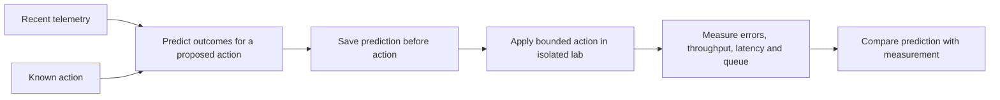
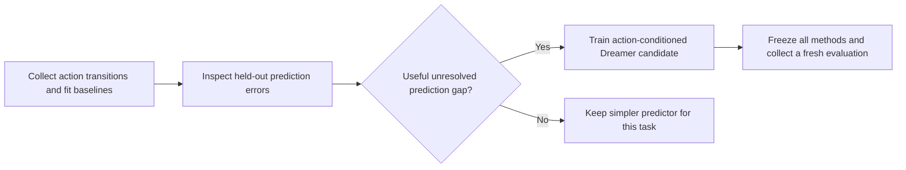
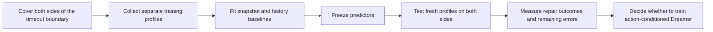

# Predict the effect of a repair

## Question

Given recent telemetry and a proposed action, can a model predict what happens next?
The previous snapshot screen was already strong at naming faults. This experiment
moves to outcomes, where an action can reduce latency while leaving every request
failed, or clear a queue by sacrificing most throughput.

## First step: establish simple action-aware baselines

Use four actions: do nothing, remove injected database degradation, reduce offered
load to 2 requests/s, or disable retries. Database repair does not add capacity to an
already healthy database. Measure error fraction, successful requests/s, mean window
p95 latency, and mean queue depth separately; do not hide load shedding behind a
single recovery score.

Collect 36 trials from nine workload profiles. Each profile is independently recreated
under all four actions, in shuffled order. The first six profiles (24 trials) are
training; the remaining three (12 trials) are testing. All action variants of a profile
stay in the same split. These are recreated trials, not identical counterfactual worlds.
Only three independent test profiles means this is feasibility work, not confirmation.

| Measurement | Protocol |
|---|---|
| Conditions | Healthy, database degradation, upstream overload |
| Variation | Base load 18–34/s; burst 65–115/s; healthy DB hold 30–50 ms; degraded hold 80–120 ms |
| Fault onset | Randomized between seconds 2 and 3 |
| Action | Second 6, after saving the prediction |
| Outcome | Final windows from seconds 12–16 |
| Input | Last window or last four pre-action windows, plus proposed action |
| Excluded | Fault label, injected settings, profile ID, event timestamps, post-action telemetry |
| Safety | Eight client requests; 16 active requests/service; leased controls; drain before reset |

Compare action-specific averages, ridge regression using the current window, and ridge
regression using four ordered windows. All regressions include action interactions.
Select regularization from 1, 10, 100 with leave-profile-out cross-validation on training
data. Select the reference method by training CV error-fraction MAE; freeze all models
before any test trial. Report all methods and all four outcome errors. No test-driven
retuning, and no action-selection reliability claim from this small sample.

## Where DreamerV3 fits next

DreamerV3 learns a latent model of transitions from observations and actions. A future
candidate would learn from these action-labelled telemetry sequences and roll forward
under each proposed intervention. This requires a new observation/action adapter and
training on the new data; the existing steady-fault checkpoint is not a validated
predictor for this task.

First verify collection, prediction timing and baseline performance. Then determine
whether there is a measured gap worth testing with Dreamer. If proceeding, train the
candidate only on training profiles and compare it with strong current-window and
history baselines on a new, jointly frozen evaluation. The present test may inform
research design, but must not later be described as untouched confirmation for a
candidate developed after seeing it.

All execution stays in `systems-world-model-lab`. Full telemetry and model artifacts
remain on its results volume. The UI displays aggregate baseline errors and cleanup
status; no new Dreamer result is claimed by this first step.

## Interrupted-run recovery

The initial run stopped after 35 trials because the final trial failed the sampling
interval check before its prediction/action. All completed trial cleanup passed, and
the controller restored the lab. Recovery preserves the original failed run, copies
its completed trials and frozen models, verifies saved test predictions against those
models, and retries only the missing trial using the same scheduled profile/action.
It does not relax sampling checks or retune predictors. The replacement trial is a
new physical realization and is disclosed as such in the final result.

## First screening result — 24 November 2026

Run `cf9ad6cbed1c` completed the dataset from source run `3269c31c2b54`
using recovery code `16d9b47`. The original 35 trials, 11 saved test predictions,
and frozen model file were verified byte-identical (47 files). Only the final
trial was recreated; all 12 test predictions were saved before their interventions.
All 36 trial cleanup checks passed.

The history predictor was selected using training CV before testing. Held-out
mean absolute errors across 12 trials from three independent profiles were:

| Predictor | Error fraction (percentage points) | Successful requests/s | Latency (ms) | Queue depth |
|---|---:|---:|---:|---:|
| Action-specific average | 48.32 | 7.47 | 52.67 | 5.43 |
| Current-window ridge | 10.43 | 4.56 | 28.85 | 1.00 |
| Four-window history ridge | **5.33** | **3.99** | **21.90** | **0.55** |

History reduced error-fraction MAE by about 49% relative to the current-window
baseline in this screen, and had lower errors on all four measured outcomes.
This supports testing temporal information for intervention prediction. It does
not establish a Dreamer advantage: no Dreamer model was trained or evaluated here.
Three independent test profiles are too few to establish reliable generalization.

Next, repeat the frozen-baseline comparison on more independently sampled profiles
without retuning on these results. If the temporal benefit persists, collect a
larger training-only transition dataset for an action-conditioned Dreamer candidate;
compare it against the history baseline on a fresh, jointly frozen evaluation.
The current screen remains exploratory and must not become that final test set.

## Next validation: frozen models, new workloads

**Goal:** establish whether recent history improves repair-outcome prediction on
new workloads before training an action-conditioned DreamerV3 candidate.

The next batch uses nine new independent profiles (three per condition), each
recreated under all four actions: 36 trials. It copies the exact frozen predictors
from `cf9ad6cbed1c`, uses a fresh random seed, retains the original workload ranges,
and performs no training or tuning. Predictions are saved before each action;
telemetry timing and cleanup checks remain unchanged. Source artifacts are retained.

The primary comparison remains mean absolute error in post-action error fraction:
history versus current-window ridge. Report all four outcome errors and profile-level
paired differences for the complete batch, including failures; do not stop early for
a favorable score. Lower error on the primary measure is the immediate success
criterion, with per-profile consistency and the other outcomes qualifying the result.
This is validation within the existing workload ranges, not new-fault generalization.

If the benefit persists, the next milestone is an action-conditioned DreamerV3 model
trained on a separate, larger transition dataset, evaluated against the frozen
history baseline on fresh workloads. The ultimate goal is better diagnosis and
repair recommendations; this experiment measures a prerequisite—predicting repair
outcomes—and does not yet establish reliable root-cause diagnosis or action choice.

## Fresh validation and diagnosis — 24 November 2026

Run `15999a239bf1` completed all 36 trials across nine new profiles. All cleanup
checks passed and the controller restored the lab. The predictors were verified
byte-identical to the source screening run; no training or retuning occurred.

| Held-out MAE | Current window | Four-window history |
|---|---:|---:|
| Error fraction (percentage points) | **17.00** | 17.78 |
| Successful requests/s | 3.80 | **3.41** |
| Latency (ms) | **27.83** | 33.25 |
| Queue depth | **1.41** | 1.64 |

The earlier primary-metric gain did not replicate. History won on five of nine
profiles, but its mean paired error was 0.78 percentage points worse. An exploratory
paired profile bootstrap (20,000 resamples, seed 20261124) gave a 95% percentile
interval of -1.69 to +3.18 points for history minus snapshot. Nine profiles are too
few for a strong inference; this does not establish superiority or equivalence.

### Where it helped and hurt

| Condition (12 trials each) | Current-window error MAE (pp) | History error MAE (pp) |
|---|---:|---:|
| Healthy | 2.27 | **1.80** |
| Database degradation | **44.16** | 44.31 |
| Upstream overload | **4.57** | 7.24 |

Across conditions, disabling retries favored history (7.41 vs 13.38 pp), while
removing database degradation favored the current window (20.67 vs 30.14 pp).
These post-hoc subgroups are diagnostic, not separate confirmed wins. Both methods
were poor on database degradation followed by load reduction: 73.66/74.67 pp error.

### A concrete training coverage gap

The request attempt timeout is fixed at **100 ms**. Although training and validation
sampled the same configured 80–120 ms database-delay range, their few realized
profiles landed on opposite sides of that boundary:

| Database profiles | Training | Fresh validation |
|---|---:|---:|
| Independent profiles | 2 | 3 |
| Injected delay range | 105.93–109.40 ms | 83.22–93.07 ms |
| Profiles below 100 ms | 0 | 3 |
| Observed errors after reducing load | 100% in both | 0% in all three |

At low load, a delay longer than the attempt timeout can still fail every request;
a shorter delay can complete once queueing is relieved. This is a plausible
mechanistic explanation for the load-reduction prediction failure, supported by the
observed coverage and outcomes. It is not a controlled causal test, and it does not
fully explain the variable database-repair outcomes (some still had 100% errors).
Injected settings were used only for this diagnostic audit, never as predictor inputs.

### Decision and next experiment

Keep the current-window predictor as the simpler reference; retain history as a
challenger. Do not claim a Dreamer benefit or scale up Dreamer training on this evidence.
The immediate issue to address is sparse coverage of different system behaviors.

For the next collection, stratify database delays below, near, and above 100 ms;
cover offered loads below and above pool capacity, with all four actions for each
profile. Use distinct profiles in training and testing, balancing these regimes in
both. Include repeated trials of a few fixed profiles to measure outcome variability
and investigate the database-repair failures. Keep these diagnostic repeats separate
from the held-out score. Preserve input exclusions, pre-action prediction timing,
resource limits, and cleanup checks. Do not add fault settings as model features.

Choose the exact sample budget and freeze the protocol before collection. Fit and
select models only with grouped training folds. Report overall and regime-specific
error-fraction MAE, throughput, latency, queue errors, and profile-level paired
comparisons on fresh data. The completed screening and validation batches now inform
experiment design and must not serve as untouched tests for new candidates.

This analysis did not start another training run or change runtime services.
