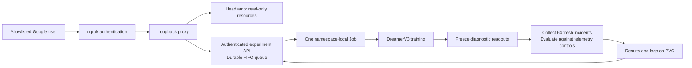

# Shared training experiments

The experiment launcher uses the lab's existing Google sign-in and email allowlist.
Open **Experiments** in Headlamp, choose a name, training seed and step budget,
then queue a run. The approved 128-incident training dataset is fixed and hash checked.
A 1,000-step run checks the pipeline; use 100,000 steps for research comparisons.



Users can view and cancel their own experiments. `099.raj@gmail.com` can manage
all experiments. Headlamp resource views remain shared across allowed users;
run ownership is enforced by the launcher API, not a promise of private Kubernetes logs.
The navigation plugin initializes Headlamp’s default/allowed namespace filter to
`systems-world-model-lab`; Kubernetes RBAC enforces the actual boundary.
Add teammates using the existing ngrok Google email allowlist.

Only one experiment runs at a time. The controller records the inference deployment
before pausing it, then restores its replica count after completion, failure or
cancellation. It refuses to overwrite unrelated deployment changes. Cancellation
waits for worker termination and fault lease expiry before releasing the lab.
Queued requests and recovery state survive controller restarts on the results PVC.

## Results

The UI reports latent-model and raw-telemetry accuracy at six and eight observation
windows. Fresh test incidents are collected **after** readouts are frozen; seeds
are separate from training. Six-window scores are shadow-prefix evaluations,
not measured collection-time savings. Without a matched prior-model baseline,
a run does not establish improvement over earlier models. See [training protocol](TRAINING.md).

## Deployment

Build with the `Experiment images` GitHub Actions workflow. Download its
`experiment-images` artifact containing digest-pinned `images.json`.
`python -m launcher.manifests images.json` renders the namespace-scoped backend,
RBAC, network policies and Headlamp navigation plugin. The ingress requires the
existing ngrok-verified email header and signs internal API requests using a shared
Secret. Keep the API private and mount that Secret only in the proxy/controller.
The proxy listens on loopback port 4467 and forwards Headlamp traffic to 4466.

All Jobs use fixed images/commands and the `results` PVC; users cannot supply images,
commands, paths or Kubernetes manifests. No model checkpoints or run outputs are
stored in Git. Everything stays within `systems-world-model-lab` and its existing quota.

With existing `gh` read-package credentials and SSH access to `amd-halo`, run:

```sh
python -m launcher.deploy backend /path/to/images.json
python -m launcher.deploy ingress /path/to/images.json
python -m launcher.deploy viewer /path/to/images.json
```

The backend phase creates image-pull and internal-signing Secrets without printing
credentials. The ingress phase saves its original deployment/config in
`/tmp/swm-launcher-rollback.json` and restores them if rollout fails. Keep that
local backup until verification is complete. The viewer phase restricts the public
Headlamp service account; it does not alter personal administrator bindings.

## Launcher verification — 2026-11-19

Thirty automated checks passed. UI-submitted smoke run `edadb698d417` completed
training, frozen readouts and 64 fresh validation incidents in 15m47s, including
its first image download. The controller deleted its worker and restored the
**exact original inference deployment spec**. Forged unsigned email headers were
rejected; public Headlamp Job creation and controller writes outside the lab were denied.
This 1,000-step smoke run verifies operation, not diagnostic quality.
Cancellation/restart recovery passed automated tests; a second live cancellation
run was not submitted because automatic approval review rejected the extra run.

## Upload a training dataset

Expand **Upload training dataset**, enter a name, choose a UTF-8 `.jsonl` file,
confirm it contains training incidents only, then click **Validate and upload**.
An accepted dataset is selected automatically; queueing training is a separate action.
Errors identify the invalid row or missing fault-family coverage. Uploads are visible
to their uploader and the administrator, immutable, and pinned by SHA-256 in each run.

The current protocol accepts 64–256 incidents (2 MiB maximum) with the same eight
measurement windows and fault labels used by the lab. See the [format guide](../launcher/static/dataset-format.md).
Use **Download selected dataset** to inspect its exact contents. The historical
built-in corpus retains some old split annotations; uploads marked `test` or
`validation` are rejected even if the old corpus was explicitly assigned to training.
New `microservice.collect --split train` output follows the supported format.

The API checks ownership again when a dataset is selected or downloaded. It rejects
known held-out seeds, copied trajectories from retained launcher test runs, duplicate
incidents, nonfinite telemetry, unsupported schemas, and insufficient group coverage.
Fresh evaluation remains separate. These checks cannot independently establish the
provenance or correct fault labels of arbitrary external data.

## Persistent results and trends

**Results over time** shows all completed runs you are authorized to view, oldest
first, with Dreamer/telemetry scores at six and eight windows, a matched prior-model
score when available, gate outcomes and report downloads. Smoke tests are hidden
from this view by default and can be included explicitly. History is loaded from
the results PVC, not kept only in browser memory.

Click a run to open its details. The URL retains the selected run ID through refresh;
without a selection, the newest completed non-smoke result opens automatically.
Each run normally has a different test batch, so the trend is descriptive. Only
scores within a run's matched comparison establish a same-test comparison.

Expanded run `ea18a74cd710` completed in 43m06s: Dreamer6 63/64, telemetry6 60/64,
Dreamer8 63/64, telemetry8 62/64, prior frozen model6 62/64 on the same test.
Reliability and regime checks passed; the improvement gate did not (only one more
correct diagnosis and equal false-pool counts). Next: repeat frozen-model comparisons
on fresh batches before changing the model or claiming a reliable improvement.

## Frozen-model repeat tests

Operator-queued runs labeled **TEST ONLY** collect a new 64-incident test batch and
evaluate two completed, frozen source models on identical measurements. They never
train or refit readouts. The displayed step count describes the source model's
original training budget. Source run IDs appear in the report; `protocol.json`
records both checkpoints, readouts and training identities. Hashes are verified
before and after testing. Each repeat appears as a separate row in Results over time.
