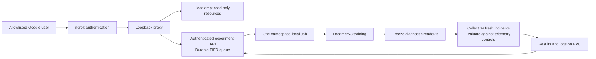

# Shared training experiments

The experiment launcher uses the lab's existing Google sign-in and email allowlist.
Open **Experiments** in Headlamp, choose a name, training seed and step budget,
then queue a run. The approved 128-incident training dataset is fixed and hash checked.
A 1,000-step run checks the pipeline; use 100,000 steps for research comparisons.

Users can view and cancel their own experiments. `099.raj@gmail.com` can manage
all experiments. Headlamp resource views remain shared across allowed users;
run ownership is enforced by the launcher API, not a promise of private Kubernetes logs.
Add teammates using the existing ngrok Google email allowlist.

Only one experiment runs at a time. The controller records the inference deployment
before pausing it, then restores its replica count after completion, failure or
cancellation. It refuses to overwrite unrelated deployment changes. Cancellation
waits for worker termination and fault lease expiry before releasing the lab.
Queued requests and recovery state survive controller restarts on the results PVC.

## Results

The UI reports latent-model and raw-telemetry accuracy at six and eight observation
windows. Fresh test incidents are collected **after** readouts are frozen; seeds
are separate from training. Six-window scores are shadow-prefix evaluations,
not measured collection-time savings. Without a matched prior-model baseline,
a run does not establish improvement over earlier models. See [training protocol](TRAINING.md).

## Deployment

Build with the `Experiment images` GitHub Actions workflow. Download its
`experiment-images` artifact containing digest-pinned `images.json`.
`python -m launcher.manifests images.json` renders the namespace-scoped backend,
RBAC, network policies and Headlamp navigation plugin. The ingress requires the
existing ngrok-verified email header and signs internal API requests using a shared
Secret. Keep the API private and mount that Secret only in the proxy/controller.
The proxy listens on loopback port 4467 and forwards Headlamp traffic to 4466.

All Jobs use fixed images/commands and the `results` PVC; users cannot supply images,
commands, paths or Kubernetes manifests. No model checkpoints or run outputs are
stored in Git. Everything stays within `systems-world-model-lab` and its existing quota.
