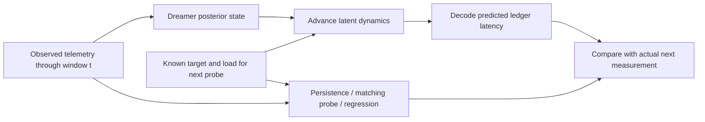

# Can Dreamer predict the next measurement?

Diagnosis results have not established a Dreamer advantage: 125/128 correct versus
127/128 for raw telemetry. This experiment instead tests its learned dynamics.

## Fixed protocol before fresh collection

- Frozen source model: `782a827a06f9`, seed 113; no model retraining or diagnosis-head use.
- Collect 64 new balanced incidents using the ledger-first schedule after controls freeze.
- Each incident yields four one-step predictions: after 4, 5, 6 and 7 observations.
  Each prediction sees only its actual prefix and known next probe target/load.
  Later predictions may use newly observed earlier windows: this is one-step forecasting,
  not a four-step open-loop rollout or an unmeasured counterfactual.
- Target is next-window ledger latency. Use Dreamer's stochastic prior transition and
  decoder directly, averaging 16 particles with fixed RNG seed 777. Labels never enter.
- Persistence predicts the last ledger measurement. Matching-probe persistence uses
  the latest earlier measurement with the requested target and load, falling back to
  persistence. A ridge regression sees the same padded telemetry prefix and known action.
- Fit regression only on the source model's exact 192 training incidents. Choose penalty
  from 0.01, 0.1, 1, 10, 100 using repeat-modulo-four grouped cross-validation. Select
  the comparison control by training CV MAE (persistence controls have no fitted weights).
- Primary metric: MAE in log1p(latency / 0.1 seconds), averaged within incident then across
  incidents. Also report MAE in milliseconds and separately by observation prefix.
  For millisecond reporting, clamp negative predicted log latency to zero for all methods.
- Success: at least 10% less primary error than the training-selected control, with a
  paired incident bootstrap 95% interval for candidate-minus-control error entirely below
  zero (2,000 resamples, seed 20261121). Report every control, including stronger controls
  on the test batch; passing this gate alone does not mean beating all controls.

A prepare phase verifies actual Dreamer prior/decoder execution using training data
before collecting tests. Control hashes, source checkpoint hashes, protocol and particle
budget are saved. No tuning uses this new test batch. A successful first batch must still
be repeated. Prediction skill would not by itself establish reliable RCA, planning or
safe remediation.

The existing queue reserves only `systems-world-model-lab`, retains the one-hour worker
cap, resets leased faults and restores inference. UI detail and downloadable report
show forecasting error separately from diagnosis accuracy. No existing results are replaced.
