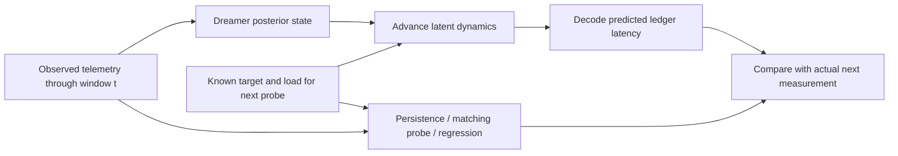
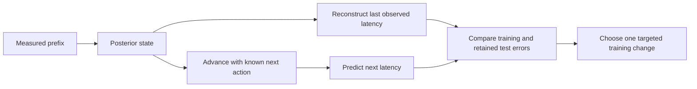

# Can Dreamer predict the next measurement?

Diagnosis results have not established a Dreamer advantage: 125/128 correct versus
127/128 for raw telemetry. This experiment instead tests its learned dynamics.

## Fixed protocol before fresh collection

- Frozen source model: `782a827a06f9`, seed 113; no model retraining or diagnosis-head use.
- Collect 64 new balanced incidents using the ledger-first schedule after controls freeze.
- Each incident yields four one-step predictions: after 4, 5, 6 and 7 observations.
  Each prediction sees only its actual prefix and known next probe target/load.
  Later predictions may use newly observed earlier windows: this is one-step forecasting,
  not a four-step open-loop rollout or an unmeasured counterfactual.
- Target is next-window ledger latency. Use Dreamer's stochastic prior transition and
  decoder directly, averaging 16 particles with fixed RNG seed 777. Labels never enter.
- Persistence predicts the last ledger measurement. Matching-probe persistence uses
  the latest earlier measurement with the requested target and load, falling back to
  persistence. A ridge regression sees the same padded telemetry prefix and known action.
- Fit regression only on the source model's exact 192 training incidents. Choose penalty
  from 0.01, 0.1, 1, 10, 100 using repeat-modulo-four grouped cross-validation. Select
  the comparison control by training CV MAE (persistence controls have no fitted weights).
- Primary metric: MAE in log1p(latency / 0.1 seconds), averaged within incident then across
  incidents. Also report MAE in milliseconds and separately by observation prefix.
  For millisecond reporting, clamp negative predicted log latency to zero for all methods.
- Success: at least 10% less primary error than the training-selected control, with a
  paired incident bootstrap 95% interval for candidate-minus-control error entirely below
  zero (2,000 resamples, seed 20261121). Report every control, including stronger controls
  on the test batch; passing this gate alone does not mean beating all controls.

A prepare phase verifies actual Dreamer prior/decoder execution using training data
before collecting tests. Control hashes, source checkpoint hashes, protocol and particle
budget are saved. No tuning uses this new test batch. A successful first batch must still
be repeated. Prediction skill would not by itself establish reliable RCA, planning or
safe remediation.

The existing queue reserves only `systems-world-model-lab`, retains the one-hour worker
cap, resets leased faults and restores inference. UI detail and downloadable report
show forecasting error separately from diagnosis accuracy. No existing results are replaced.

## Superseded result — 21 November 2026

**Scoring bug found:** the original evaluator omitted the inverse of the decoder's
symlog transform. The table below preserves the original output for traceability;
it is not a valid assessment of Dreamer forecast accuracy. The corrective diagnostic
reproduces these raw outputs and rescales each particle before averaging.

Run `99fc86f8d57b` completed all 64 fresh incidents / 256 forecasts; the controller
restored the lab. The frozen model **did not pass** the predeclared success gate.

| Method | Log-latency MAE (primary) | Latency MAE |
|---|---:|---:|
| Telemetry regression (selected control) | 0.1088 | 38.1 ms |
| Last matching probe | 0.1366 | 51.5 ms |
| Last observation | 0.1989 | 76.5 ms |
| Dreamer prior + decoder | 0.3933 | 134.7 ms |

Dreamer's primary error was 3.61 times the selected control's. The paired incident
bootstrap 95% interval for Dreamer-minus-regression error was **[0.2237, 0.3478]**,
entirely above zero. This is evidence of worse forecasting on this batch, not improvement.

### What the error analysis shows

Aggregates were computed inside the namespace; incident telemetry remains on the PVC.
Dreamer's mean log-latency prediction was 0.7324 versus observed 1.1230, with signed
bias -0.3906. Prediction standard deviation was 0.2460 versus observed 0.5144.
The error is therefore dominated by underprediction and compressed variation.
Dreamer did better than regression in the healthy and CPU-only subgroups, but worse
in each of the six other fault groups. These are exploratory slices of eight incidents
per group, not independent evidence of a successful method.

Source training metrics show vector reconstruction loss falling from 5.1239 at step
2,660 to 0.0319 at step 98,600. This aggregate training loss uses the decoder's loss
and all vector dimensions; it is **not comparable numerically** to held-out ledger
forecast MAE. It motivates checking posterior reconstruction separately from prior
prediction, but does not establish the cause of the failure.

### Next diagnostic before further training

Use the same frozen checkpoint and particle budget. Measure posterior reconstruction
of the last observed window and prior forecasting of the next window on both source
training incidents and this retained test set. Report bias and error by window and
fault group. Reconstruction is diagnostic only: it has seen its target and must never
be presented as a forecast baseline. Verify action alignment and decoder output units.

- Good reconstruction but poor prior forecasts: investigate transition/prior learning
  and a directly supervised next-observation training objective.
- Poor reconstruction too: investigate decoder fidelity and representation capacity.
- Good training forecasts but poor retained-test forecasts: investigate generalization.

Do not tune on this batch and call it held out again. Any subsequent change must be
selected on training/validation data and assessed with fresh incidents. No additional
training or fault collection was launched during this aggregate error analysis.

## Decoder-scale correction

The pinned upstream `Head.symlog_mse` constructs `MSE(pred, nets.symlog)`.
`MSE.loss` transforms the target, while `MSE.pred` returns the transformed mean
without inversion. Our evaluator must apply `symexp` before comparing that output
with the observation vector's log-latency value. This is separate from converting
log-latency to milliseconds. Invert each particle first, then average.

The first retrospective audit (`ad7d2694ce33`) reproduced original raw forecasts
exactly and exposed similar underprediction in reconstruction and forecasting,
including training data. This triggered the library source inspection above.
Those uncorrected audit errors are also superseded. Model weights and diagnosis
results are unchanged. Corrected retained-test scores are retrospective and require
fresh confirmation before claiming improvement.

## Corrected retrospective result

Run `9dfd68aa18f5` completed the audit with unchanged checkpoint/data hashes and
**zero difference** from the original raw decoder predictions. Corrected values
invert symlog for each of the 16 particles before averaging.

| Split | Posterior reconstruction log MAE | Next-window forecast log MAE |
|---|---:|---:|
| Training, 192 incidents | 0.06168 | 0.07663 |
| Retained test, 64 incidents | 0.06877 | 0.09271 |

On the retained test, corrected Dreamer forecasting MAE is **34.74 ms**, versus
**38.07 ms** for the frozen telemetry regression. Primary log MAE improves **14.8%**
(0.09271 versus 0.10881); the paired incident bootstrap 95% interval for the error
difference is **[-0.03045, -0.00145]**. The numerical gate passes on this retrospective
rescore. This is not an independent replication or evidence of improved diagnosis.

Reconstruction MAE is 27.49 ms on retained data; it sees the target measurement and
is diagnostic only. Forecasting is harder, but the large shared downward bias was
caused by the missing inverse transform. There is no basis from this audit alone to
increase model size or change the training objective. Training-versus-test differences
also do not by themselves prove or rule out overfitting.

**Next experiment:** repeat the corrected frozen forecasting protocol on a new seed
and 64 fresh balanced incidents, keeping the model, controls, particle count, schedule,
metric and success gate fixed. Do not retrain or tune using the retained test batch.

## First fresh confirmation — 21 November 2026

Run `3d66a2902e2b`, fresh collection seed `1054344277`, completed 64 incidents /
256 predictions in **13 minutes 8 seconds**, including reservation and restoration.
Checkpoint, training data, baseline fit and protocol settings matched the earlier run.
The corrected evaluator was fixed before this batch was collected; no retraining occurred.

| Method | Log MAE (primary) | Latency MAE |
|---|---:|---:|
| Dreamer | **0.08322** | **30.50 ms** |
| Frozen telemetry regression | 0.11025 | 38.45 ms |
| Last matching probe | 0.13461 | 53.18 ms |
| Last observation | 0.20572 | 81.80 ms |

Dreamer reduced primary error by **24.5%** versus the preselected regression control.
The paired incident bootstrap 95% error-difference interval was
**[-0.04129, -0.01342]**. The fixed improvement gate passed on this fresh batch.

This supports one-step prediction under this measured schedule, not improved RCA,
unseen-action planning, or remediation. Matching-probe persistence still beats Dreamer
at prefixes 6 and 7 individually (log MAE 0.04455 / 0.04507 versus 0.08110 / 0.06247).
Do not infer that Dreamer is best at every window. A future stronger comparator could
select a baseline by prefix using training data only; that would be a separate protocol.

Next: one additional fresh batch using the same frozen settings, without tuning, to
check repeatability. Keep retrospective and prospective evidence clearly distinguished.
