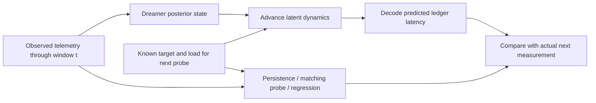
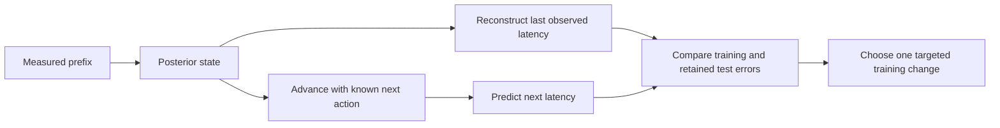

# Can Dreamer predict the next measurement?

Diagnosis results have not established a Dreamer advantage: 125/128 correct versus
127/128 for raw telemetry. This experiment instead tests its learned dynamics.

## Fixed protocol before fresh collection

- Frozen source model: `782a827a06f9`, seed 113; no model retraining or diagnosis-head use.
- Collect 64 new balanced incidents using the ledger-first schedule after controls freeze.
- Each incident yields four one-step predictions: after 4, 5, 6 and 7 observations.
  Each prediction sees only its actual prefix and known next probe target/load.
  Later predictions may use newly observed earlier windows: this is one-step forecasting,
  not a four-step open-loop rollout or an unmeasured counterfactual.
- Target is next-window ledger latency. Use Dreamer's stochastic prior transition and
  decoder directly, averaging 16 particles with fixed RNG seed 777. Labels never enter.
- Persistence predicts the last ledger measurement. Matching-probe persistence uses
  the latest earlier measurement with the requested target and load, falling back to
  persistence. A ridge regression sees the same padded telemetry prefix and known action.
- Fit regression only on the source model's exact 192 training incidents. Choose penalty
  from 0.01, 0.1, 1, 10, 100 using repeat-modulo-four grouped cross-validation. Select
  the comparison control by training CV MAE (persistence controls have no fitted weights).
- Primary metric: MAE in log1p(latency / 0.1 seconds), averaged within incident then across
  incidents. Also report MAE in milliseconds and separately by observation prefix.
  For millisecond reporting, clamp negative predicted log latency to zero for all methods.
- Success: at least 10% less primary error than the training-selected control, with a
  paired incident bootstrap 95% interval for candidate-minus-control error entirely below
  zero (2,000 resamples, seed 20261121). Report every control, including stronger controls
  on the test batch; passing this gate alone does not mean beating all controls.

A prepare phase verifies actual Dreamer prior/decoder execution using training data
before collecting tests. Control hashes, source checkpoint hashes, protocol and particle
budget are saved. No tuning uses this new test batch. A successful first batch must still
be repeated. Prediction skill would not by itself establish reliable RCA, planning or
safe remediation.

The existing queue reserves only `systems-world-model-lab`, retains the one-hour worker
cap, resets leased faults and restores inference. UI detail and downloadable report
show forecasting error separately from diagnosis accuracy. No existing results are replaced.

## Completed result — 21 November 2026

Run `99fc86f8d57b` completed all 64 fresh incidents / 256 forecasts; the controller
restored the lab. The frozen model **did not pass** the predeclared success gate.

| Method | Log-latency MAE (primary) | Latency MAE |
|---|---:|---:|
| Telemetry regression (selected control) | 0.1088 | 38.1 ms |
| Last matching probe | 0.1366 | 51.5 ms |
| Last observation | 0.1989 | 76.5 ms |
| Dreamer prior + decoder | 0.3933 | 134.7 ms |

Dreamer's primary error was 3.61 times the selected control's. The paired incident
bootstrap 95% interval for Dreamer-minus-regression error was **[0.2237, 0.3478]**,
entirely above zero. This is evidence of worse forecasting on this batch, not improvement.

### What the error analysis shows

Aggregates were computed inside the namespace; incident telemetry remains on the PVC.
Dreamer's mean log-latency prediction was 0.7324 versus observed 1.1230, with signed
bias -0.3906. Prediction standard deviation was 0.2460 versus observed 0.5144.
The error is therefore dominated by underprediction and compressed variation.
Dreamer did better than regression in the healthy and CPU-only subgroups, but worse
in each of the six other fault groups. These are exploratory slices of eight incidents
per group, not independent evidence of a successful method.

Source training metrics show vector reconstruction loss falling from 5.1239 at step
2,660 to 0.0319 at step 98,600. This aggregate training loss uses the decoder's loss
and all vector dimensions; it is **not comparable numerically** to held-out ledger
forecast MAE. It motivates checking posterior reconstruction separately from prior
prediction, but does not establish the cause of the failure.

### Next diagnostic before further training

Use the same frozen checkpoint and particle budget. Measure posterior reconstruction
of the last observed window and prior forecasting of the next window on both source
training incidents and this retained test set. Report bias and error by window and
fault group. Reconstruction is diagnostic only: it has seen its target and must never
be presented as a forecast baseline. Verify action alignment and decoder output units.

- Good reconstruction but poor prior forecasts: investigate transition/prior learning
  and a directly supervised next-observation training objective.
- Poor reconstruction too: investigate decoder fidelity and representation capacity.
- Good training forecasts but poor retained-test forecasts: investigate generalization.

Do not tune on this batch and call it held out again. Any subsequent change must be
selected on training/validation data and assessed with fresh incidents. No additional
training or fault collection was launched during this aggregate error analysis.
