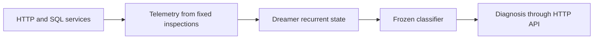

# Isolated Dreamer triage API

Current candidate: model seed **23**, controller **inspect-latent**, source **microservice-source-v20**. The model and frozen classifier package lives at `/results/micro-latent-api-v1/serving` on the lab PVC. The serving pod sees only this minimal package, the Python runtime and upstream code. No fitting or fault controls are exposed by the API.

Check `reports/evidence/latent-api/promotion.json` for the recorded deployment decision and classifier hash. The earlier experiment `completion.json` records the pre-promotion experiment outcome; these are separate events.

## Serving path



## Readiness

On the AMD host, use the lab-only port forward:

```sh
kubectl --kubeconfig="$HOME/.kube/graphrobin.yaml" -n systems-world-model-lab port-forward service/swm-inference 8088:8088
```

In another terminal on that host:

```sh
curl --fail http://127.0.0.1:8088/health
```

The response should report readiness and seed 23. This checks inference readiness, not application health.

## Diagnosis contract

POST `/act` with exactly `seed`, `vector`, `first`, `reward`, and `incident_id`. Use seed 23, a fresh UUID per incident, and the 14-value physical-v2 observation contract in `microservice/environment.py`. Start with `first=true`, reward 0. Subsequent inspection observations use `first=false` and cost reward -0.2. Never submit a correctness reward or a fault label.

The controller requests actions 1, 2 and 3 (CPU, pool and trace inspection), then returns action 4 plus a three-bit fault mask: CPU=1, pool=2, delay=4. Mask 0 means healthy. The response contains three signed `latent_scores` and the classifier artifact hash; these scores are not calibrated probabilities.

Use measured observations and the requested-sensor masks, not fabricated zero vectors. The reference interaction and clean measurement procedure are in `microservice/latent_api_evaluate.py`. It keeps truth and controls in the experiment runner and checks exact measurement counts. Its fixed scenario/output are preserved experiment evidence, not a command to rerun unchanged.

## Scope

This POC has fixed inspections and recognizes eight known fault regimes in the isolated checkout/payment/ledger/PostgreSQL chain. It returns a diagnosis only. It does not merge PRs, remediate services, handle arbitrary systems, or run LLM orchestration.

## Rollback

The original inference template is in `deploy/microservice-agent-api-restore.json`; original service sources are in `reports/evidence/latent-api/original-sources.json`. From this repository on the local host:

```sh
python3 - <<'PY'
import json
from pathlib import Path
from scripts import finish_window as ops
ops.manifest('microservice-agent-api-restore.json', 'apply')
for name, source in json.loads(Path('reports/evidence/latent-api/original-sources.json').read_text()).items():
    ops.patch_source(name, source)
ops.ready()
PY
```

The helper explicitly targets only systems-world-model-lab. Do not reapply bootstrap manifests to operate the current candidate; use the candidate/rollback manifests and preserve the experiment artifacts.
