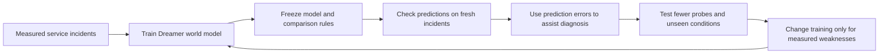
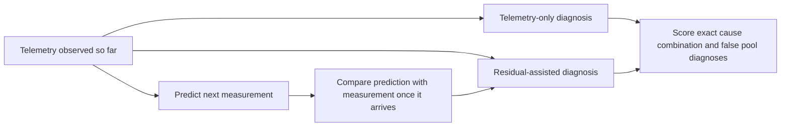

# Improving world-model triage

**Current result:** the action-conditioned Dreamer training smoke succeeded: **1,000 environment steps, 108 optimizer updates**, and a finite checkpoint from 64 training trials. Prediction accuracy is not yet evaluated. The stronger baseline remains history ridge (12.64 vs 15.72 pp error-fraction MAE for the current-window model in the balanced batch). Checkpoint reload and prior-only outcome inference are now implemented and unit-tested, awaiting their namespace smoke run; fresh evaluation follows only after that passes. See [training smoke results](ACTION_OUTCOMES.md#training-smoke-retry-succeeded--25-november-2026).

The goal is to identify system faults reliably with fewer useful measurements.
Better latency prediction is evidence that the model learned some system behavior;
it is not yet proof of better root-cause diagnosis.

| Step | Purpose | Status / decision |
|---|---|---|
| Establish telemetry and Dreamer diagnosis baselines | Check whether the model adds value | Diagnosis advantage not established |
| Test frozen-model forecasting | Check learned system behavior | Two fresh 64-incident batches passed: 24.5% and 23.3% lower log MAE than regression |
| Audit scoring | Ensure apparent gains/losses reflect model quality | Fixed decoder symlog conversion; invalid scores retained as superseded |
| Strengthen simple forecasting controls | Avoid comparing with an unnecessarily weak baseline | Select regression or persistence separately by window using training data only |
| Connect predictions to diagnosis | See whether unexpected measurements help identify causes earlier | Compare telemetry alone, telemetry plus simple forecast errors, and telemetry plus Dreamer forecast errors |
| Confirm triage benefit on fresh incidents | Distinguish exploration from dependable improvement | Only after the offline comparison; freeze readouts before collecting fresh data |
| Expand difficulty | Test generalization beyond familiar schedules | Later: new loads, severities, configurations, then service dependencies |
| Change training | Address demonstrated weaknesses | Keep model weights fixed for current comparisons; do not add capacity without evidence |

## Earlier residual-diagnosis experiment

Use the same 192 training incidents and the second completed forecasting batch as a
retained exploratory test. Fit diagnosis readouts only on training data using grouped
cross-validation. Compare the same readout candidate family for all feature sets.
The primary comparison is after **six observations**; also report four through eight.

A residual becomes available only after its measurement arrives. At observation six,
use predictions made after observations four and five; never use future measurements.
Both simple and Dreamer residuals are tested so that useful feature engineering is not
mistaken for a unique world-model benefit. Simple training residuals use out-of-fold
predictions; Dreamer remains fitted on its source training set. This asymmetry and the
reuse of retained tests make the comparison exploratory, requiring fresh confirmation.

No adaptive probe selection or early stopping is implemented here. All eight windows
were collected. Prefix accuracy estimates information requirements, not elapsed-time
savings. A later prospective experiment must measure actual probes and time saved.

## What counts as progress

- Better exact fault-combination accuracy at the same observation count, without more
  false pool accusations; or similar accuracy with fewer observations.
- Repeat the chosen approach on fresh incidents with frozen settings before calling it
  an improvement. Inspect healthy cases, individual fault families and shifted loads.
- Keep forecasting and diagnosis claims separate. An LLM can later explain measured
  evidence; it must not supply the benchmark's ground-truth verdict.

Code and reports stay in this repository; data, checkpoints and execution remain in
`systems-world-model-lab`. Existing experiments and other namespaces are untouched.

## Fresh triage confirmation

The retained-data comparison found only small diagnosis differences: at six observations,
Dreamer-assisted and telemetry-only diagnosis both scored 63/64, with zero versus one
false pool accusation. The stronger window-specific forecasting baseline essentially
tied Dreamer. These are exploratory findings, not established triage gains.

The next run freezes all 15 diagnostic readouts (three feature sets at five prefixes)
and the simple forecasting baseline before collecting 64 new balanced incidents.
Selection and fitting use only the source 192 training incidents. Model weights stay
unchanged. Stored hashes and timestamps verify that tests arrived after freezing and
that evaluation did not alter model, baseline or readout artifacts.

The primary comparison is exact fault-combination accuracy at six observations,
with paired disagreement counts and an exact paired test against each control.
False pool accusations are reported separately: fewer false alarms with unchanged
accuracy is a tradeoff to examine, not automatically proof of improved diagnosis.
Other observation counts are secondary. Report all outcomes, including ties or losses.
No actual early stopping or reduction in incident collection time is claimed.
