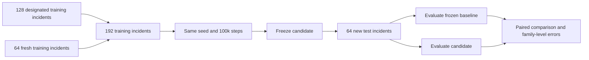

# Expand training coverage: seed 113

Question: does adding 64 fresh training incidents improve diagnosis of CPU + ledger
delay, without changing the model, training seed or step budget?

- Baseline: completed run `f4405906195f`, 128 designated training incidents,
  model seed 113, 100,000 steps. Preserve its frozen model and readouts.
- Candidate: those exact 128 incidents plus 64 newly collected training incidents,
  balanced across all eight families. Existing collector varies severity and load.
- Hold model architecture, auxiliary loss, readout selection and training budget fixed.
- Collect a new 64-incident test batch only after the candidate readouts are frozen.
- Evaluate both models sequentially on that same test file, including telemetry
  controls. Do not reuse either model's earlier test data for training.

Primary criteria: existing six-window reliability and load-regime gates; at least
2 more exact diagnoses than the baseline and fewer false pool positives. Report
CPU + delay performance separately, especially under shifted load. No claim of
statistical reliability from a single batch or seed.

The launcher records `expansion_seed` and `baseline_run` in its durable queue. These
are operator-selected protocol fields, not arbitrary commands accepted by the API.
The normal controller reserves the lab, limits the job and restores inference.
Its dataset field identifies the **base** dataset; the actual expanded training file
is `runs/RUN_ID/train.jsonl`. `protocol.json` records its hash, row count, collection
seeds and baseline hashes. Historical annotations in the designated training file
are preserved; no previous test file is relabeled or appended.

Outputs remain on the results PVC: `additional-train.jsonl`, `train.jsonl`, model,
readouts, fresh `test.jsonl`, `baseline-evaluation/` and `evaluation/`. The experiment
is visible in the existing UI; its final report includes the matched baseline score.
