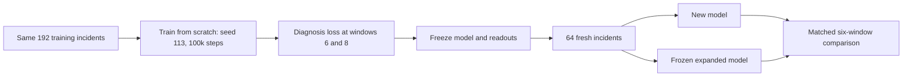

# Earlier diagnosis supervision

Question: does teaching the Dreamer representation to identify mechanisms after
six observation windows improve early diagnosis?

The expanded model scored 123/128 across two fresh batches; the original model
scored 121/128 on those same incidents. This is a small gain, not substantial proof.

Baseline: `ea18a74cd710`, with supervision only at window eight. The candidate
uses its exact training file, architecture, seed, steps, auxiliary weight and
readout selection. The sole intentional change is the supervision mask: windows
six and eight instead of eight alone. The loss averages over eligible observations;
labels remain training targets only and never enter the encoder or policy.
Terminal observations remain excluded.

The operator-only `training_source` queue field pins the baseline. The worker
verifies source hashes, copies the exact training file and records the protocol
before training. Each model is evaluated on the same fresh batch; no test data is
used for training or readout selection. Frozen model comparisons can then repeat
on a second fresh batch without training again.

Keep existing reliability and load-regime gates. The improvement gate requires
at least two additional correct six-window diagnoses and fewer false pool positives
than the matched baseline. Report telemetry controls and eight-window results too.
A repeatable advantage across fresh batches is required before calling this a useful
improvement; one training seed does not establish generality. Near-ceiling results
on this small service environment do not establish production triage performance.

Results, logs and comparison reports remain in the existing UI and results PVC.
All live operations are confined to `systems-world-model-lab`.

## Outcome

Run `0fc61b145fff`: candidate and baseline both 59/64 at six windows, with identical
errors. Earlier supervision did not improve this batch. See
[pool-error analysis](POOL_ERROR_ANALYSIS.md) for evidence and the proposed next
probe-order experiment. Preserve both models; do not promote the candidate.
