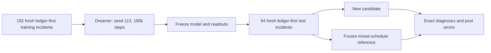

# Direct ledger probes before diagnosis

Question: does measuring ledger behavior directly before the six-window diagnosis
reduce confusion between fixed delay and pool contention?

Each incident: four checkout windows, two direct ledger windows, then two checkout
windows. Both low and high load are measured. Trajectories are collected in that
order; archived measurements are never rearranged to simulate new actions.

- Three new 64-incident training collections: seeds 20261121, 20261122, 20261123.
- Reference: `0fc61b145fff`, 192 training incidents, seed 113, 100,000 steps,
  six/eight-window supervision. Preserve its model and readouts unchanged.
- Keep architecture, telemetry fields, auxiliary weight and readout selection fixed.
- Candidate receives new training data as well as a different schedule. This is a
  feasibility experiment, not a causal ablation of schedule alone. The reference
  faces a schedule shift on the shared test batch; report that limitation.
- Freeze before collecting a new balanced 64-incident test batch. Compare both models
  on exactly that file. Retests retain the candidate's ledger-first schedule.

Success: existing reliability, family and shifted-load gates; at least two additional
six-window exact diagnoses and fewer false pool positives than the reference.
Also inspect missed pool faults so an apparent false-positive gain cannot hide a
recall regression. Report raw telemetry controls and eight-window accuracy. Repeat
on a fresh batch before claiming a repeatable gain.

The queue records `probe_training_seeds` and the frozen `training_source` before
launch. These are bounded operator-only fields, not arbitrary API commands. Workers
check source hashes, supervision identity and seed overlap; protocol files record the
actual training hash and comparison scope. The UI name/report identify the schedule.
The catalogue dataset field is only a lineage/preflight reference for this run;
the actual new training data is the run's `train.jsonl`.

Fresh collection adds runtime, so this protocol has a two-hour worker cap; normal
runs retain their one-hour cap. Controller recovery allows five additional minutes.
Fault leases, per-incident safety budgets, namespace isolation, cancellation and
inference restoration remain unchanged. No resources outside the lab are modified.

See [pool error analysis](POOL_ERROR_ANALYSIS.md) for the evidence behind this test.

## First result and frozen repeat

Run `782a827a06f9` completed in 66 minutes 35 seconds and restored inference.
On its fresh 64-incident ledger-first test batch, six-window accuracy was 63/64 for
both candidate and frozen reference, and 64/64 for the raw-telemetry classifier.
Candidate eight-window accuracy was also 63/64. Reliability, shifted-load and
matched-control gates passed; improvement and feasibility gates did not.

Candidate made one false pool diagnosis on a delay-only incident; reference missed
pool contention in one combined-fault incident. Their equal scores conceal different
errors. These results do not establish an advantage for the new world model or a
causal benefit from probe ordering.

Frozen repeat `182e90a9a3d8` was queued on 2026-11-21: collect 64 new ledger-first
incidents (test seed 1514326914), then evaluate the same candidate and reference.
No training, readout fitting or threshold tuning is performed. Both artifact hashes
are checked before and after evaluation. Preserve the raw-telemetry control and
report combined matched results once the repeat completes.
