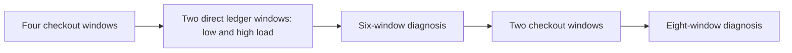

# Pool diagnosis error analysis

2026-11-20 · candidate `0fc61b145fff` · baseline `ea18a74cd710`.
This is exploratory analysis of an inspected test batch, not a new acceptance result.

Both models scored 59/64 at six windows with identical mistakes. Candidate accuracy
rose to 62/64 at eight. Checkpoints and latent features differ; training-file hashes
match. The training change worked, but did not improve final diagnoses.

| Test row (zero-based) | True fault | Six-window mistake | Direct ledger probes by six? | Correct at eight? |
|---|---|---|---|---|
| 7 | Delay | Adds pool contention | No | No |
| 34 | Delay | Adds pool contention | No | No |
| 48 | CPU + delay | Adds pool contention | No | Yes |
| 50 | CPU + pool + delay | Misses pool contention | No | Yes |
| 62 | CPU + delay | Adds pool contention | Yes | Yes |

All errors concern the pool bit. CPU and delay bits are correct throughout.
Checkout-first cases score 28/32; ledger-first cases score 31/32. These groups differ
in more than order, so this association is not a controlled estimate of benefit.

## What the evidence suggests

High latency is being confused with contention. Row 34 has approximately 377 ms
ledger latency at both loads in its final checkout pair, yet predicts contention.
Two delay-only cases remain wrong even after direct ledger probes arrive.
This suggests a representation/readout limitation as well as probe availability.

For missed contention in row 50, ledger latency rises from approximately 271 to
293 ms through checkout, but 288 to 416 ms under direct ledger probes. Payment CPU
work can stagger downstream arrivals and hide contention. This is an inference
from the implementation and telemetry, not measured arrival-timing evidence.

Load-response slopes overlap: training first-extra-pair slopes span about -0.6 to
7.2 ms/request without a pool fault and -8.2 to 53.2 with one. Nominal pool size is
eight while high-load probes use nine or ten operations, so some queueing without
an injected pool fault is expected. The label identifies injected pool reduction,
not the mere presence of queueing.

A target-aware pool-only telemetry classifier, selected by training-only grouped
cross-validation, also scores 59/64 on this inspected batch: one false positive
and four misses. This trades error types, not an improvement. It used no hidden
pool-wait counters or fault controls. Do not promote it or tune against this batch.

## Next experiment

Collect real trajectories under this fixed schedule; do not reorder old measurements
and claim newly measured action sequences. Hold telemetry, architecture, model seed,
step budget and supervision fixed. Train on the new schedule, freeze model/readouts,
then collect fresh balanced tests. Keep raw telemetry controls and repeat the test.

The existing frozen model can be evaluated on the same new test file as a reference,
but label its schedule shift: it was trained on mixed schedules. A causal claim about
schedule benefit requires equal-budget training and fresh evaluation for each schedule,
with matched fault settings and randomized collection order.

Require fewer false and missed pool diagnoses plus existing family/load-regime gates.
If delay-only false positives persist, investigate preserving load-response information
in the representation rather than simply increasing gradient steps.

No training or deployment changed during this analysis. Inspected test incidents remain
excluded from training. Source artifacts remain on the lab results PVC.
