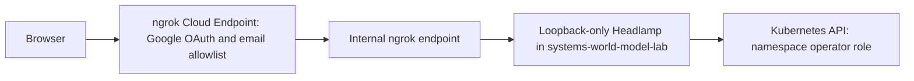

# Public lab UI: active

Public URL: https://noninstructive-unprevalently-minerva.ngrok-free.dev

The user chose the existing ngrok account, `raj.nishtala@gmail.com`, to manage
access in the ngrok dashboard. Initially only `099.raj@gmail.com` may sign into
Headlamp with Google. No ngrok team invitation or subscription upgrade is needed.
The existing account is on pay-as-you-go; this does not imply zero usage cost.

## Architecture

The Cloud Endpoint policy can be edited in the existing ngrok dashboard to add
or remove exact email addresses. Lab users do not receive ngrok dashboard access.
All allowed users share the existing namespace operator role. Kubernetes audit
records identify the shared service account rather than each Google user.

Headlamp uses a rotating projected service-account token internally. Users will
not need to paste or renew a Kubernetes token. Google/browser sessions can still
expire or be revoked; this is not a promise of a nonexpiring browser credential.

## Prepared configuration

- `deploy/ngrok/cloud-endpoint-policy.json`: Google OAuth, exact-email denial,
  removal of client identity/authorization headers, verified identity header,
  and terminal forwarding to `https://swm-headlamp.internal`.
- `deploy/ngrok/agent-config.json`: internal endpoint, loopback upstream,
  disabled local inspector. Validated by the pinned ngrok image in a restricted
  namespace Job on 2026-11-17: `Valid configuration file at /etc/ngrok/ngrok.yml`.
- `deploy/ngrok/headlamp-public-staged.json`: namespace-scoped account and role
  binding, ConfigMap, Deployment at zero replicas, and NetworkPolicy. Server-side
  dry-run passed. Headlamp binds only to loopback; no Service exposes it and pod
  ingress is denied. Only Headlamp mounts the rotating Kubernetes credential.
- `deploy/ngrok/bootstrap-oauth-policy.json`: authentication policy fragment;
  use the complete Cloud Endpoint policy for deployment.

The agent credential must be newly scoped to `bind:swm-headlamp.internal`. Never
install a broad account credential in the lab. Operators can create Jobs and
therefore must be trusted with namespace data and credentials accessible through
workload mounts; they are not mutually isolated tenants.

## Activation and verification remaining

Public Cloud Endpoint: `ep_3MFaDluGid9q3SDM3093gvIbQNm`.

Manage the exact-email allowlist in its **Traffic Policy** tab:
https://dashboard.ngrok.com/endpoints/cloud/ep_3MFaDluGid9q3SDM3093gvIbQNm/overview

The restricted agent credential is installed as `swm-ngrok-credential`. It grants
only `bind:swm-headlamp.internal`. No credential value is stored in this repository.
The public deployment is running at one replica. The former private deployment
is scaled to zero and only its Tailscale Serve port 8083 was disabled.

Google login with `099.raj@gmail.com` succeeded, and live lab workloads and events
loaded through the public UI. Five unauthenticated HTTP checks (including forged
identity headers and WebSocket upgrades) and eleven RBAC checks passed. Evidence
is in `reports/evidence/headlamp-public-access/`.

For each new browser, open **Settings > Cluster**, set **Default namespace** and
**Allowed namespaces** to `systems-world-model-lab`, pressing Enter to add the
allowed namespace. This is a display setting, not the security boundary: RBAC
continues to deny other namespaces. Cluster-wide overview panels may show a
permission warning. Use Workloads for the lab view.

To sign out of ngrok, visit:
https://noninstructive-unprevalently-minerva.ngrok-free.dev/ngrok/logout
Headlamp's Account > Log out also navigates to this endpoint through the shipped
`swm-session` plugin, clearing the outer ngrok session after local token cleanup.
Refresh an already-open tab once to load the plugin. This logs out of the lab,
not the user's Google account. The page-lifetime router listener remains active
when logout unmounts the app bar; plugin versions must change when metadata
changes because Headlamp caches compatibility by name and version.

## Runtime details and maintenance

- Start ngrok directly rather than its image entrypoint wrapper; the wrapper
  attempts to load an unrelated default config path. Config is explicitly mounted.
- Rewrite the internal upstream Host header to `127.0.0.1:4466`, as required by
  Headlamp's loopback host validation. Google auth and allowlist remain upstream.
- Headlamp temporary volume is 128Mi; 16Mi caused observed eviction during startup.
- Public HTTP egress is allowed only to eight observed IP addresses of
  `crl.ngrok-agent.com`, for its signed certificate revocation check. TLS validation
  and CRL checking remain enabled. These DNS addresses can change; update the
  exact addresses if ngrok reports CRL connection failures. This is an operational
  limitation of IP-based Kubernetes NetworkPolicy, not an automatic DNS rule.
- The staged manifest intentionally defaults to zero replicas. After applying it
  with the Secret present, explicitly scale `swm-headlamp-public` to one replica.
- Live projected-token rollover and already-open WebSocket behavior after allowlist
  revocation have not been tested. Existing upgraded connections may require
  disconnecting; do not promise immediate revocation of established connections.

All Kubernetes changes are restricted to `systems-world-model-lab`. Shared
Keycloak, other namespaces, unrelated ngrok endpoints and AutoSRE are unchanged.

## References

- https://ngrok.com/docs/gateway/traffic-policy/actions/oauth
- https://ngrok.com/docs/gateway/endpoints/cloud-endpoints
- https://ngrok.com/docs/gateway/endpoints/internal-endpoints
- https://ngrok.com/docs/api-reference/credentials/update
- https://headlamp.dev/docs/latest/installation/in-cluster/identity-aware-proxy/

## Additional validation pending

A real login attempt with non-allowlisted `raj.nishtala@gmail.com` was blocked by
automatic approval review, which requires explicit authorization for that test
account. No denial-test result is claimed. Allowlist changes/revocation should
also be tested with a dedicated authorized test identity.

## Cross-tab logout and browser history

Session plugin 0.1.3 broadcasts logout to same-origin tabs with BroadcastChannel
and a localStorage generation marker. Tabs immediately hide rendered data and
navigate to ngrok logout, unloading watches and connections. Restored browser
cache pages revalidate with a full navigation before showing data. Authenticated
Headlamp responses use Cache-Control: no-store. Google itself remains signed in.

Refresh every tab opened before this update once to install the new client code.
Older already-running JavaScript cannot receive this behavior retroactively.
Validation: `node scripts/test_headlamp_session.cjs`, plus two-tab Firefox logout
and Back navigation. Both live tabs reached the signed-out page after one logout.
