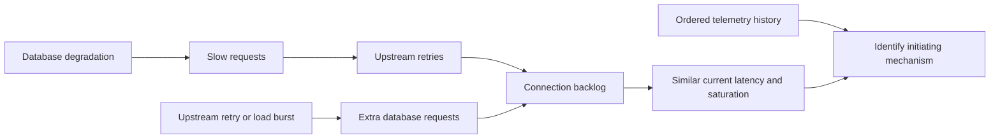

# Next question: can history distinguish the initiating fault?

## Why we are changing direction

The steady-fault demo is close to a telemetry ceiling. In the fresh six-observation
comparison, telemetry diagnosed 64/64 incidents and Dreamer-assisted telemetry 62/64.
Dreamer beat a single regression forecast baseline, but a stronger window-specific
baseline matched or beat it. More runs of this setup are not our next priority.

## One concrete incident to investigate

A slow checkout can result from **database degradation that triggers retries**, or
from **an upstream retry/load burst that overloads a healthy database**. At diagnosis
time, both can show high request latency, saturated connections and a request backlog.
The investigation must determine which happened first and which intervention addresses
it: relieve database degradation, or suppress the upstream amplification.

The lab now supports bounded retries and continuous telemetry. The first pilot
reproduced database-triggered retries but did not overload the healthy database.
Both mechanisms must work before this becomes a training benchmark.

## Build and validate the incident before training

1. Add bounded, explicit retry behavior to the isolated demo, disabled by default.
   Record original requests, attempts, timeouts, active requests and queue waits.
   Keep the fault lease and a deadline for the entire incident. Drain all outstanding
   requests before resetting the lab; abort if restoration cannot be verified.
2. Collect continuous windows during onset, amplification and recovery. Preserve
   state between windows. Separate metric snapshots from fault/connection resets.
3. Exercise both initiating mechanisms with overlapping final symptoms. Randomize
   onset, severity, workload, background noise and incident order independently of
   the label. Keep mechanism controls and event timestamps out of model inputs.
4. Check the mechanism through bounded interventions in separate validation incidents:
   remove database degradation versus suppress retries. These establish experimental
   ground truth; the triage model must not observe the intervention answer.
5. Run a small feasibility pilot. If the final telemetry snapshot alone distinguishes
   the two classes reliably, or interventions do not distinguish the mechanisms,
   stop and redesign this scenario before training Dreamer.

All service changes and experiments remain in `systems-world-model-lab`. No changes
are needed to AutoSRE, other namespaces, or the public UI's access controls.

## Compare against strong alternatives

| Method | Information available |
|---|---|
| Current-snapshot classifier | Current telemetry only |
| Aggregated-history classifier | Min/max/mean/variation without event order |
| Ordered-history classifier | The same complete sequence as Dreamer |
| Simple onset/lag rules | Training-selected ordering and lag features |
| Dreamer-based diagnosis | Learned state from the same sequence |

Include an order-destruction check with consistently shuffled training and evaluation
sequences. This distinguishes useful ordering from merely having more observations.
A weak snapshot baseline is a scenario check, never Dreamer's primary competitor.
Use the same telemetry, observation budget and held-out incidents for all comparisons.
Exclude fault IDs, injection settings, run IDs, seeds and absolute wall-clock timestamps
from features. Hold out complete incidents and collection seeds, never individual windows.

## One decision rule

Before a confirmatory run, freeze the training set, telemetry schema, diagnosis time,
model/readouts and the strongest training-selected history baseline. Fix a fresh test
size using pilot disagreement rates, targeting detection of a 10-percentage-point
accuracy gain with 80% power at a two-sided 5% level. Do not repeatedly inspect results
and keep collecting until a favorable outcome appears.

Call Dreamer useful only if it improves exact initiating-mechanism accuracy by at least
10 percentage points over that history baseline, the paired 95% interval excludes zero,
and it does not increase false alarms on healthy incidents. Treat healthy controls as
an additional class and report shifted-load results separately. Fewer probes or faster
resolution require a separate measured stopping/intervention experiment.

If history helps but a simple history method matches Dreamer, adopt the simpler method
for this task and stop presenting Dreamer as an improvement. If neither method succeeds,
review observability and ground truth rather than increasing model size by default.

## Current status

**First pilot complete; upstream burst needs calibration.** No new Dreamer training
has started. Validate the scenario before collecting a randomized benchmark.

## Foundation implementation

Retries are disabled by default. Opt-in controls permit at most two retries, bounded
per-attempt timeouts, backoff and a total downstream deadline. The pilot uses just one
retry. A timeout does not cancel work already running downstream; active-request and
pool-wait counters expose that backlog. Retired pools close returning connections.

`/metrics/window?after=<sequence>` reads completed-request windows without resetting
faults, connection pools or counters. Boot identifiers and missing-window checks reject
restarts or gaps. Changing delay/hold parameters preserves the existing pool. The legacy
explicit measurement-reset endpoint remains available to the steady-fault collector.

The first pilot has nine incidents: healthy, database slowdown, or upstream load burst,
each with no relief, database relief, or upstream load/retry relief. Each has 3 seconds
of baseline, onset at second 3, relief at second 9, and 12 seconds of bounded traffic.
At most eight client requests are in flight. Controls have 45-second leases. After
stopping arrivals, wait for client calls and verify all services and pool waiters are
quiet before resetting; fail rather than reset over undrained work.

This is an instrumentation/mechanism check, **not** the final randomized benchmark.
Severity and onset are deliberately fixed for this pilot; one case per intervention
cannot establish generalization or causal efficacy statistically. Inspect baseline,
incident and relief telemetry before designing the larger validity dataset. Do not
train Dreamer on these nine incidents or report diagnosis accuracy from them.

### Deployment checkpoint — 23 November 2026

Instrumentation is deployed to checkout, payment and ledger in the lab namespace.
The post-rollout healthy-chain check passed, continuous-window telemetry responded,
and default retries remained zero. All 100 tests passed, including a real HTTP
retry/timeout test. The rollout is reproducible with `scripts/deploy_temporal_services.py`.

Pilot `5a6a43c1a820` completed all nine incidents and restored the lab.

| Mechanism | Incident checkout latency* | Payment timeouts | Relief outcome |
|---|---:|---:|---|
| Healthy | 47–48 ms | 0 | Remained healthy |
| Database slowdown | 216 ms | 16–18 | Database relief restored 47 ms and zero timeouts |
| Upstream burst | 48 ms | 0 | No congestion to relieve |

*Mean of window p95 values; timeout counts cover the interior sampled interval.
Disabling retries in the degraded-database case reduced latency to 104 ms but left
timeouts: faster failure is not recovery.

The original burst target was 40 requests/s, below the approximate 50 requests/s
capacity of two connections held for 40 ms. The revised pilot targets 120 requests/s
with the same eight-request concurrency cap, one retry, leases and drain checks.
Its scheduler sleeps 2 ms instead of 10 ms; actual arrivals remain bounded and can
fall below the target. Record submitted/dropped requests and failures as well as
latency. This calibration is not evidence of improved diagnosis.
