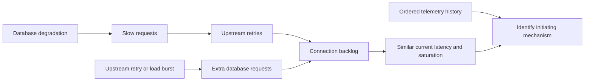
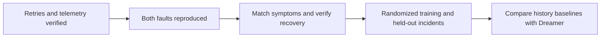
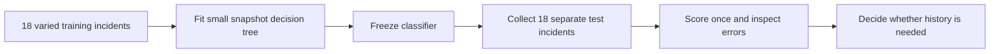
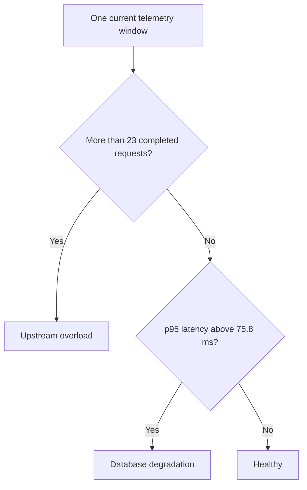

# Next question: can history distinguish the initiating fault?

## Why we are changing direction

The steady-fault demo is close to a telemetry ceiling. In the fresh six-observation
comparison, telemetry diagnosed 64/64 incidents and Dreamer-assisted telemetry 62/64.
Dreamer beat a single regression forecast baseline, but a stronger window-specific
baseline matched or beat it. More runs of this setup are not our next priority.

## One concrete incident to investigate

A slow checkout can result from **database degradation that triggers retries**, or
from **an upstream retry/load burst that overloads a healthy database**. At diagnosis
time, both can show high request latency, saturated connections and a request backlog.
The investigation must determine which happened first and which intervention addresses
it: relieve database degradation, or suppress the upstream amplification.

The lab now supports bounded retries and continuous telemetry. The first pilot
reproduced database-triggered retries but did not overload the healthy database.
Both mechanisms must work before this becomes a training benchmark.

## Build and validate the incident before training

1. Add bounded, explicit retry behavior to the isolated demo, disabled by default.
   Record original requests, attempts, timeouts, active requests and queue waits.
   Keep the fault lease and a deadline for the entire incident. Drain all outstanding
   requests before resetting the lab; abort if restoration cannot be verified.
2. Collect continuous windows during onset, amplification and recovery. Preserve
   state between windows. Separate metric snapshots from fault/connection resets.
3. Exercise both initiating mechanisms with overlapping final symptoms. Randomize
   onset, severity, workload, background noise and incident order independently of
   the label. Keep mechanism controls and event timestamps out of model inputs.
4. Check the mechanism through bounded interventions in separate validation incidents:
   remove database degradation versus suppress retries. These establish experimental
   ground truth; the triage model must not observe the intervention answer.
5. Run a small feasibility pilot. If the final telemetry snapshot alone distinguishes
   the two classes reliably, or interventions do not distinguish the mechanisms,
   stop and redesign this scenario before training Dreamer.

All service changes and experiments remain in `systems-world-model-lab`. No changes
are needed to AutoSRE, other namespaces, or the public UI's access controls.

## Compare against strong alternatives

| Method | Information available |
|---|---|
| Current-snapshot classifier | Current telemetry only |
| Aggregated-history classifier | Min/max/mean/variation without event order |
| Ordered-history classifier | The same complete sequence as Dreamer |
| Simple onset/lag rules | Training-selected ordering and lag features |
| Dreamer-based diagnosis | Learned state from the same sequence |

Include an order-destruction check with consistently shuffled training and evaluation
sequences. This distinguishes useful ordering from merely having more observations.
A weak snapshot baseline is a scenario check, never Dreamer's primary competitor.
Use the same telemetry, observation budget and held-out incidents for all comparisons.
Exclude fault IDs, injection settings, run IDs, seeds and absolute wall-clock timestamps
from features. Hold out complete incidents and collection seeds, never individual windows.

## One decision rule

Before a confirmatory run, freeze the training set, telemetry schema, diagnosis time,
model/readouts and the strongest training-selected history baseline. Fix a fresh test
size using pilot disagreement rates, targeting detection of a 10-percentage-point
accuracy gain with 80% power at a two-sided 5% level. Do not repeatedly inspect results
and keep collecting until a favorable outcome appears.

Call Dreamer useful only if it improves exact initiating-mechanism accuracy by at least
10 percentage points over that history baseline, the paired 95% interval excludes zero,
and it does not increase false alarms on healthy incidents. Treat healthy controls as
an additional class and report shifted-load results separately. Fewer probes or faster
resolution require a separate measured stopping/intervention experiment.

If history helps but a simple history method matches Dreamer, adopt the simpler method
for this task and stop presenting Dreamer as an improvement. If neither method succeeds,
review observability and ground truth rather than increasing model size by default.

## Current status

**Randomized snapshot screen completed: 17/18 held-out incidents correct.**
A depth-two tree using request count and latency meets the predeclared descriptive
screen. Keep it as the baseline; this scenario does not yet justify Dreamer training.
The sample is small and does not establish production reliability.

## Foundation implementation

Retries are disabled by default. Opt-in controls permit at most two retries, bounded
per-attempt timeouts, backoff and a total downstream deadline. The pilot uses just one
retry. A timeout does not cancel work already running downstream; active-request and
pool-wait counters expose that backlog. Retired pools close returning connections.

`/metrics/window?after=<sequence>` reads completed-request windows without resetting
faults, connection pools or counters. Boot identifiers and missing-window checks reject
restarts or gaps. Changing delay/hold parameters preserves the existing pool. The legacy
explicit measurement-reset endpoint remains available to the steady-fault collector.

The first pilot has nine incidents: healthy, database slowdown, or upstream load burst,
each with no relief, database relief, or upstream load/retry relief. Each has 3 seconds
of baseline, onset at second 3, relief at second 9, and 12 seconds of bounded traffic.
At most eight client requests are in flight. Controls have 45-second leases. After
stopping arrivals, wait for client calls and verify all services and pool waiters are
quiet before resetting; fail rather than reset over undrained work.

This is an instrumentation/mechanism check, **not** the final randomized benchmark.
Severity and onset are deliberately fixed for this pilot; one case per intervention
cannot establish generalization or causal efficacy statistically. Inspect baseline,
incident and relief telemetry before designing the larger validity dataset. Do not
train Dreamer on these nine incidents or report diagnosis accuracy from them.

### Deployment checkpoint — 23 November 2026

Instrumentation is deployed to checkout, payment and ledger in the lab namespace.
The post-rollout healthy-chain check passed, continuous-window telemetry responded,
and default retries remained zero. All 100 tests passed, including a real HTTP
retry/timeout test. The rollout is reproducible with `scripts/deploy_temporal_services.py`.

Pilot `5a6a43c1a820` completed all nine incidents and restored the lab.

| Mechanism | Incident checkout latency* | Payment timeouts | Relief outcome |
|---|---:|---:|---|
| Healthy | 47–48 ms | 0 | Remained healthy |
| Database slowdown | 216 ms | 16–18 | Database relief restored 47 ms and zero timeouts |
| Upstream burst | 48 ms | 0 | No congestion to relieve |

*Mean of window p95 values; timeout counts cover the interior sampled interval.
Disabling retries in the degraded-database case reduced latency to 104 ms but left
timeouts: faster failure is not recovery.

The original burst target was 40 requests/s, below the approximate 50 requests/s
capacity of two connections held for 40 ms. The revised pilot targets 120 requests/s
with the same eight-request concurrency cap, one retry, leases and drain checks.
Its scheduler sleeps 2 ms instead of 10 ms; actual arrivals remain bounded and can
fall below the target. Record submitted/dropped requests and failures as well as
latency. This calibration is not evidence of improved diagnosis.

### Calibrated pilot — 23 November 2026

Run `0381be81c030` (code `ea50baf`) completed all nine cases; every case drained and
reset successfully. Healthy controls remained at 46–49 ms with zero sampled failures.
The stronger upstream burst now produces timeouts and a persistent queue.

| Incident | Checkout latency* | Peak sampled ledger waiters | Effect of intended relief |
|---|---:|---:|---|
| Database slowdown | 215–216 ms | 0 | Database relief: 48 ms, zero sampled failures |
| Upstream burst | 216 ms | 81–128 | Load/retry relief: fewer attempts, but backlog and failures persist in the short relief window |

Without relief, burst queue depth reached 151 in the final phase; applying database
relief to the burst did not resolve it (peak 172). Database relief here means removing
injected degradation; it adds no capacity to an already healthy database. Upstream
relief combines load reduction and retry suppression, so this pilot does not isolate
the effect of those two actions. Client counts in the summary are the last sampled
window, not final totals; restoration is checked separately after client completion.

**Decision: do not train yet.** Similar latency alone does not make this a challenging
history-based diagnosis: queue depth and traffic volume distinguish the two cases.
The 3-second relief period is also too short to establish burst recovery. The next
scenario revision should:

1. Use overlapping workload and queue-depth ranges for both initiating mechanisms,
   while keeping injected control values out of model features.
2. Bound server backlog as well as client concurrency; timed-out work keeps running
   downstream, so eight clients alone do not cap outstanding server requests.
3. Observe a separately bounded recovery period long enough to measure successful
   requests and queue clearance. Distinguish load shedding from retry suppression.
4. Recheck snapshot separability and intervention outcomes before collecting training
   data. If the current snapshot still suffices, use the simpler triage method.

We are at **C**. This is progress in experiment validity, not measured improvement
in Dreamer's diagnosis accuracy.

### Next bounded recovery pilot

The next pilot uses 24 requests/s before onset for both faults, then retains 24 for
database degradation or raises it to 96 for upstream overload. Both may now queue.
Active work is capped atomically at 16 requests per service in the pilot (default 64);
excess requests return counted 503 failures without entering downstream work. This
bounds application work, not all HTTP connection/thread overhead.

Twelve cases separate database relief, load reduction to 2 requests/s, retry suppression,
and no relief for each of three mechanisms. Onset stays at 3 seconds; relief at 9;
traffic continues until 22. The final 18–22 second window measures completed and failed
requests, timeouts, admission rejections and queue depth. Client totals include calls
that finish during shutdown. Leases and drain-before-reset checks remain in effect.

This is still a calibration pilot with fixed settings, not a randomized benchmark.
Direct database timing, traffic counts or rejection rates may still make current-state
triage sufficient; retain those features and report that limitation rather than hide them.

### Bounded recovery results — 23 November 2026

Run `89f1ac3c616a`, code `42bbe6f`, completed 12 cases. All case cleanup checks passed;
104 local tests passed, including real concurrent HTTP admission/rejection. The healthy
service chain passed after deployment. Both faults reached 16 active ledger requests
and 14 pool waiters; no sampled service exceeded the 16-request admission limit.

The table uses the final 18–22 second observation period. Counts are counter differences
between its first and last samples, not totals for the entire incident.

| Fault and intervention | Successful / completed requests | Checkout latency* | Peak queue | Interpretation |
|---|---:|---:|---:|---|
| Database fault → database repair | 76 / 76 | 48 ms | 0 | Recovered |
| Database fault → reduced load | 0 / 7 | 216 ms | 0 | Queue cleared, underlying fault remains |
| Database fault → retries off | 0 / 82 | 105 ms | 14 | Faster failure, not recovery |
| Upstream overload → reduced load | 7 / 7 | 46 ms | 0 | Recovered at reduced offered load |
| Upstream overload → database relief | 3 / 298 | 121 ms | 14 | Not recovered |
| Upstream overload → retries off | 1 / 300 | 104 ms | 14 | Not recovered |

*Mean of window p95 values. Database relief removes injected degradation; it does not
add capacity when the database is already healthy. Successful load shedding does not
prove the system can serve the original overloaded demand. Healthy controls had zero
client errors across all four cases. No-relief fault cases remained unhealthy.

**What this establishes:** the experiment can reproduce two bounded failure mechanisms
with the same peak queue depth and can distinguish successful relief from faster errors.
Each intervention has only one case; this is feasibility evidence, not a statistical
causal estimate or diagnosis evaluation.

**Why Dreamer is still on hold:** during the pre-relief incident windows, the existing
ledger `db_mean` ranged from 11–13 ms for overload versus 37.5–75.9 ms for database
faults. This metric averages across all completed requests, including rejected requests
with zero database time; it is not a pure database-duration measurement. Throughput
and admission rejections also differ. Do not remove these useful available features
just to create an apparent advantage for history.

The next useful dataset is a small randomized calibration set varying offered load,
database hold time and onset, with complete incidents held out. Report conditional
query duration separately from rejection rate, then test a simple snapshot classifier
before ordered-history methods. If snapshots remain sufficient, stop developing this
scenario as evidence for Dreamer and retain the simpler diagnosis. A separate naturally
history-dependent scenario would then need its own justification.

### Randomized snapshot screen — frozen before collection

Collect 36 new incidents: 18 training and 18 testing, six of each class per split.
Separate deterministic collection seeds generate the two groups. Shuffle incidents
within each split; finish and freeze the classifier before collecting the test group.
Both groups use the same ranges, so this tests new incidents within the configured
conditions, not transfer to other systems or unseen regimes.

| Parameter | Range |
|---|---|
| Background load, shared across classes | 18–34 requests/s |
| Healthy database hold | 30–50 ms |
| Degraded database hold | 80–120 ms |
| Upstream burst | 65–115 requests/s |
| Fault onset | 2–4 seconds |

Each incident runs for 11 seconds without relief, retaining all admission limits,
leases and drain checks. Select the first completed telemetry window at or after
second 10. Inputs are current-window measurements, active-work gauges and counter
increments within that window. Exclude timestamps, cumulative counters, settings,
labels and event history. Report query-only database duration separately from the
legacy all-request average; rejected requests must not look like fast database calls.

Fit one fixed depth-two CART classifier (minimum two training incidents per leaf).
Choose features/thresholds using training incidents only; no hyperparameter search or
test-driven retries. Publish the confusion matrix and a Wilson interval for overall
accuracy. A descriptive promising screen requires at least 17/18 correct, at least
5/6 per class, and zero healthy false alarms. This small test cannot establish high
reliability. A failed screen is not evidence that Dreamer would succeed.

### Snapshot screening result — 23 November 2026

Run `d517e1431475`, code `7f130c1`, completed all 36 incidents and restored the lab.
The classifier was saved after 18 training incidents, before any test collection.
All sampled active-work counts stayed at or below 16. The authenticated results API
serves the score, and the experiment UI now displays the score, per-class counts,
interval and cleanup status. All 109 tests passed.

| Actual class | Correct / test incidents | Error |
|---|---:|---|
| Healthy | 6 / 6 | None |
| Database degradation | 6 / 6 | None |
| Upstream overload | 5 / 6 | One classified as database degradation |
| Overall | **17 / 18 (94.4%)** | Wilson 95% interval **74.2–99.0%** |

The frozen tree used only `checkout.count` and `checkout.latency_p95`:

These are learned lab thresholds, not portable operating rules. Counts depend on the
approximately half-second measurement window. Although query-only database timing was
available, the tree did not select it. No fault settings, event timestamps or ordered
history were used. No thresholds were changed after inspecting test results.

**Decision:** the simple snapshot baseline meets the predeclared promising screen.
Do not train Dreamer on this scenario to manufacture an advantage. Keep the tree and
this untouched test result as reference evidence. More validation under shifted
conditions would be needed before relying on the tree operationally; this is a small,
same-environment screen, not a head-to-head Dreamer comparison.

Further world-model research should target a separately justified question where
current state is insufficient—for example predicting the effect of a bounded action
from partial observations—and compare against strong simple action-conditioned models.
Do not discard informative telemetry merely to make that comparison favorable.
