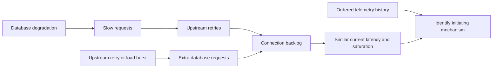

# Next question: can history distinguish the initiating fault?

## Why we are changing direction

The steady-fault demo is close to a telemetry ceiling. In the fresh six-observation
comparison, telemetry diagnosed 64/64 incidents and Dreamer-assisted telemetry 62/64.
Dreamer beat a single regression forecast baseline, but a stronger window-specific
baseline matched or beat it. More runs of this setup are not our next priority.

## One concrete incident to investigate

A slow checkout can result from **database degradation that triggers retries**, or
from **an upstream retry/load burst that overloads a healthy database**. At diagnosis
time, both can show high request latency, saturated connections and a request backlog.
The investigation must determine which happened first and which intervention addresses
it: relieve database degradation, or suppress the upstream amplification.

These are hypotheses to reproduce, not behavior already demonstrated by the current
lab. Its collector drains each request batch and resets measurement windows; its
services do not implement a retry policy. Reordering the existing CPU and pool controls
would test a scripted ordering label, not demonstrate a causal cascade. Do not use that
shortcut as evidence for better real-system root-cause analysis.

## Build and validate the incident before training

1. Add bounded, explicit retry behavior to the isolated demo, disabled by default.
   Record original requests, attempts, timeouts, active requests and queue waits.
   Keep the fault lease and a deadline for the entire incident. Drain all outstanding
   requests before resetting the lab; abort if restoration cannot be verified.
2. Collect continuous windows during onset, amplification and recovery. Preserve
   state between windows. Separate metric snapshots from fault/connection resets.
3. Exercise both initiating mechanisms with overlapping final symptoms. Randomize
   onset, severity, workload, background noise and incident order independently of
   the label. Keep mechanism controls and event timestamps out of model inputs.
4. Check the mechanism through bounded interventions in separate validation incidents:
   remove database degradation versus suppress retries. These establish experimental
   ground truth; the triage model must not observe the intervention answer.
5. Run a small feasibility pilot. If the final telemetry snapshot alone distinguishes
   the two classes reliably, or interventions do not distinguish the mechanisms,
   stop and redesign this scenario before training Dreamer.

All service changes and experiments remain in `systems-world-model-lab`. No changes
are needed to AutoSRE, other namespaces, or the public UI's access controls.

## Compare against strong alternatives

| Method | Information available |
|---|---|
| Current-snapshot classifier | Current telemetry only |
| Aggregated-history classifier | Min/max/mean/variation without event order |
| Ordered-history classifier | The same complete sequence as Dreamer |
| Simple onset/lag rules | Training-selected ordering and lag features |
| Dreamer-based diagnosis | Learned state from the same sequence |

Include an order-destruction check with consistently shuffled training and evaluation
sequences. This distinguishes useful ordering from merely having more observations.
A weak snapshot baseline is a scenario check, never Dreamer's primary competitor.
Use the same telemetry, observation budget and held-out incidents for all comparisons.
Exclude fault IDs, injection settings, run IDs, seeds and absolute wall-clock timestamps
from features. Hold out complete incidents and collection seeds, never individual windows.

## One decision rule

Before a confirmatory run, freeze the training set, telemetry schema, diagnosis time,
model/readouts and the strongest training-selected history baseline. Fix a fresh test
size using pilot disagreement rates, targeting detection of a 10-percentage-point
accuracy gain with 80% power at a two-sided 5% level. Do not repeatedly inspect results
and keep collecting until a favorable outcome appears.

Call Dreamer useful only if it improves exact initiating-mechanism accuracy by at least
10 percentage points over that history baseline, the paired 95% interval excludes zero,
and it does not increase false alarms on healthy incidents. Treat healthy controls as
an additional class and report shifted-load results separately. Fewer probes or faster
resolution require a separate measured stopping/intervention experiment.

If history helps but a simple history method matches Dreamer, adopt the simpler method
for this task and stop presenting Dreamer as an improvement. If neither method succeeds,
review observability and ground truth rather than increasing model size by default.

## Current status

**Design fixed; live retry/cascade instrumentation is not implemented or deployed.**
No further steady-fault repetitions or Dreamer training runs were started as part of
this design reset. Next implementation milestone is a bounded continuous collector
and retry instrumentation, followed by the scenario-validity pilot—not another model
hyperparameter sweep. This document is the primary next-experiment plan.
