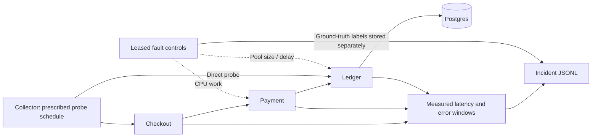
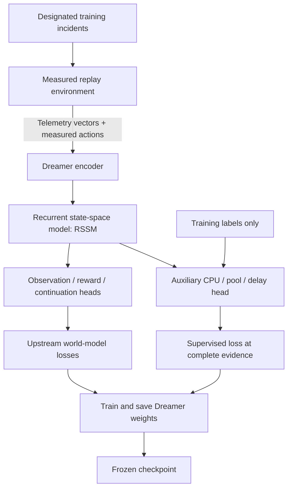
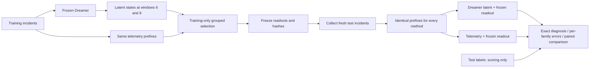

# Training and validation

## Objective

When checkout becomes slow, distinguish payment CPU saturation, ledger connection-pool contention, ledger delay, or combinations of those causes. Determine whether Dreamer's learned state diagnoses these incidents better than the same raw telemetry—and eventually with fewer probes.

## System and observations



All live collection stays in `systems-world-model-lab`. The current benchmark uses eight windows: four checkout windows, then two checkout and two direct-ledger windows in balanced order. Each pair uses low/high concurrency; the test includes original loads 3/9 and shifted loads 4/10. Fault controls have 45-second leases, each incident has a 35-second checked budget, and controls reset after every incident and on exit.

Each model observation is a 14-value vector: log-scaled latency measurements; current target/load; declared next target/load; availability, progress and completion flags; ledger error rate. Direct-ledger windows mask unavailable upstream telemetry. Fault IDs and control values are excluded. The declared next action is known schedule metadata, not a future measurement.

## Training architecture



DreamerV3 learns a recurrent latent model of how observations evolve with actions. We reuse the pinned upstream encoder, RSSM, decoder and training loop, adding a supervised mechanism head. Labels are removed from encoder, decoder and policy inputs; a runtime audit checks that changing labels cannot change policy outputs.

The existing size1m configuration uses 100,000 environment steps, batch 8 × 16, replay capacity 10,000 and train ratio 16. Weights are trained from scratch unless an explicit matching resume is requested. Replay rejects actions that were not measured. Upstream actor/critic machinery remains present, but this experiment uses a fixed probe schedule and zero rewards: **it does not establish learned remediation or free-form counterfactual planning**.

## Validation architecture



1. **Train:** use designated training incidents only. Never recycle completed tests into a later training set without explicitly redefining that experiment's split.
2. **Fit readouts:** extract 640-dimensional latent states (16-particle mean) and flattened telemetry at six/eight windows. Select among eight linear/RBF ridge configurations using leave-repeat-modulo-four-out validation; fit selected readouts on training data only.
3. **Freeze:** record training seeds, input hash, checkpoint hash, readout hash and timestamp. Readout selection assesses a frozen model already trained on those incidents; its CV score is development evidence, not independent model generalization.
4. **Test:** collect 64 new incidents with a new seed after freezing: eight fault families × four repeats × two regimes. Reject seed overlap, premature collection and incomplete coverage.
5. **Compare:** use identical incidents for all models. Report exact three-bit diagnosis, healthy/family/regime accuracy, false pool positives, bit errors and paired discordance. A prior model comparison requires byte-identical test data.

The prior engineering gate for six-window diagnosis is ≥58/64, healthy 8/8 and each family ≥6/8; each regime ≥29/32, healthy 4/4 and each family ≥3/4; within two correct of telemetry6 and Dreamer8. To claim improvement over a prior six-window model, also require ≥2 additional correct diagnoses and fewer false pool positives. Without a baseline, the improvement/overall gates are reported as unevaluated. These engineering gates are not statistical significance tests; paired p-values are exploratory and unadjusted.

All eight windows are currently collected. Scoring a six-window prefix measures diagnostic accuracy, **not actual time/request savings**. One architecture, known fault families and one training seed do not establish generalization.

## Run the workflow

Use Python 3.11 or 3.12. Obtain the pinned upstream code; keep its license. `RUN` is an external output directory, not a source directory.

```sh
git clone https://github.com/danijar/dreamerv3.git /tmp/dreamerv3
git -C /tmp/dreamerv3 checkout e01491fad6434b2245a3b8ca201dd7faedcc458c
python3 -m venv /tmp/swm-venv
. /tmp/swm-venv/bin/activate
pip install -r requirements-cpu.txt
export DREAMER_SOURCE=/tmp/dreamerv3
export PYTHONPATH="$PWD:$DREAMER_SOURCE"
export OPENBLAS_NUM_THREADS=1 OMP_NUM_THREADS=1
export XLA_FLAGS='--xla_cpu_multi_thread_eigen=false intra_op_parallelism_threads=1'
export RUN=/absolute/path/to/new-run
mkdir -p "$RUN"
```

Training data must follow the incident schema in `tests/fixtures.py`, with real measured windows, seed/fault/repeat/regime and collection time. For the existing experiment, recover the 128 designated training rows using the artifact-recovery command below. Alternatively, collect new training incidents **inside an authorized lab runner pod**:

```sh
# Runner must use namespace systems-world-model-lab and label swm-role=runner.
# Supply POD_NAMESPACE using Kubernetes' downward API, not a cross-namespace override.
python -m microservice.collect --split train --seed 9601 --out "$RUN/train.jsonl"
```

A collection creates 64 incidents. To combine training batches, use distinct seeds and concatenate only explicitly designated training files. The numeric seeds below are examples: use unused test seeds and register the experimental protocol before collection.

```sh
# Offline: genuinely updates Dreamer weights.
python -m microservice.train --data "$RUN/train.jsonl" \
  --out "$RUN/models" --seed 111 --steps 100000

# Offline: fits readouts without changing the model.
python -m microservice.validate fit --data "$RUN/train.jsonl" \
  --models "$RUN/models" --seed 111 --out "$RUN/readouts"

# Lab runner only; collect AFTER all compared readouts are frozen.
python -m microservice.collect --split test --seed 9602 --out "$RUN/test.jsonl"

# Offline: scores fixed six/eight-window prefixes.
python -m microservice.validate evaluate --data "$RUN/test.jsonl" \
  --models "$RUN/models" --seed 111 --readouts "$RUN/readouts" \
  --out "$RUN/evaluation"
```

For a paired comparison, freeze the baseline's readouts before collecting that test, evaluate it on the same test file, then supply `--baseline /path/to/baseline-evaluation` to the candidate evaluation. The comparator is the baseline's six-window prediction, using its own checkpoint and readout. Each evaluation process loads one model; do not load several large models into the same constrained runner.

Training outputs `models/final-SEED/`, `models/train-SEED/config.yaml` and training metadata. **Keep these together:** loading a checkpoint requires its generated config and metadata. Fitting outputs `readouts.npz`, `frozen.json`, extracted features and audit results. Evaluation outputs predictions, summary, features, audit and provenance. These are runtime artifacts, not repository files.

The current lab has limited shared quota. An operator must account for serving inference before launching a training job and restore its exact deployment afterward. This source cleanup neither provisions a cluster nor changes the existing lab. No service account is needed by the Python trainer; collector traffic is scoped to lab service DNS and control ports. Keep the existing namespace/network policies and leased-fault service implementation.

## Check the code

```sh
PYTHONDONTWRITEBYTECODE=1 python -m pytest -q -p no:cacheprovider
```

The cleanup was checked against the latest archived experiment: identical observation vectors, readout selection, fitted coefficients, scores and gates. These checks do not substitute for a new runtime training test when changing Dreamer or JAX versions.

## Artifact recovery

Historical experiment code and evidence remain at commit `763e555`; no Git history was rewritten. Retrieve only what a run needs:

```sh
# Reuse the 128 designated training incidents; excludes previous test incidents.
git show 763e555:reports/evidence/probe-retrain-v1/collection/train.jsonl > "$RUN/train.jsonl"

# Optional: recover the complete evidence to an external directory.
mkdir -p "$RUN/archive"
git archive 763e555 reports/evidence/probe-retrain-v1 | tar -x -C "$RUN/archive"
python scripts/verify_cleanup.py \
  --evidence "$RUN/archive/reports/evidence/probe-retrain-v1"
```

The actual Dreamer101 weights remain on the lab results PVC at `/results/probe-retrain-v1/models/final-101`; the matching runtime config is in `models/train-101/config.yaml`. No PVC data is deleted by this cleanup. RCAEval datasets and other ignored local artifacts are not part of the maintained training source; retain them separately if needed for a distinct experiment.
