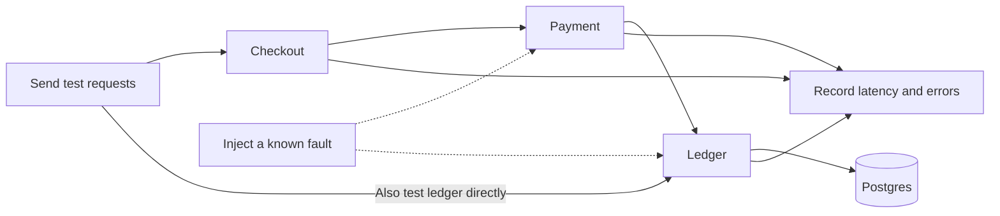
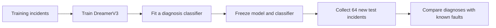
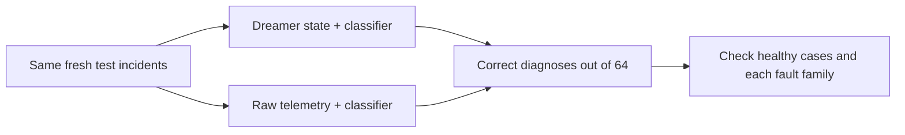

# Training and testing the world model

## What are we trying to learn?

When checkout slows down, can the model identify **what went wrong and where**?
The lab tests three causes: payment CPU saturation, ledger connection-pool
contention, and ledger delay. These can occur alone or together, giving eight
cases including a healthy system.

The main question is: **does DreamerV3 diagnose these issues more accurately than
using the same telemetry directly?**

## The system we observe



Everything runs inside `systems-world-model-lab`. Faults expire automatically
and are reset after each incident.

An **incident** is one example: a known fault and eight short measurement windows.
The first four windows test checkout. The remaining four test checkout and ledger
at different request loads. The fault label is the answer used for training and
scoring; it is not included in the model's telemetry input.

## What happens in an experiment?



1. **Train the world model.** DreamerV3 learns how measurements change as requests
   are sent through the services. Each run trains new weights unless explicitly
   configured to resume a matching checkpoint.
2. **Learn to diagnose.** A small classifier, called a *readout*, turns Dreamer's
   learned state into a prediction of the three fault causes. Training also uses
   an auxiliary fault-prediction head to help the state capture useful signals.
3. **Freeze everything.** Save the model, classifier, dataset identity and settings.
   No more learning or tuning happens against the final test batch.
4. **Test on fresh incidents.** Collect 64 new examples covering all eight cases
   under two request-load settings. Their labels are used only to score predictions.
5. **Compare fairly.** Give Dreamer and a telemetry-only classifier the same
   measurements, then count how often each identifies the complete set of causes.

DreamerV3 is the reused world-model implementation: its encoder, recurrent state
model, decoder and training loop learn a compact representation of the system's
behavior. This experiment uses a fixed request schedule. It does **not** yet learn
which probe to run next or how to repair a fault.

## Run it in the UI

Open [Experiments](https://noninstructive-unprevalently-minerva.ngrok-free.dev/experiments/):

1. Enter a run name and select a training dataset.
2. Choose a **model seed** and training steps.
3. Click **Queue experiment**, then follow its progress and results.

| Setting | Meaning | Starting choice |
|---|---|---|
| Training dataset | Examples the model learns from | Built-in 128-incident dataset |
| Model seed | Controls randomized training choices; record it to help reproduce a run | Keep it fixed when comparing a change, then repeat with other seeds |
| Training steps | How much training to perform | 100,000 for comparisons; 1,000 only to check the workflow |
| Test seed | Controls the fresh test collection | Assigned separately by the launcher |

To use your own data, expand **Upload training dataset**. Upload a training-only
JSONL file containing 64–256 incidents, up to 2 MiB. The file must match the
[dataset format](../launcher/static/dataset-format.md); arbitrary CSV files are
not supported. Uploading does not start training.

One experiment runs at a time. The launcher pauses serving inference while training
and restores it afterward. Models and results stay on the lab's persistent storage,
not in Git. See [UI and operations guide](EXPERIMENTS_UI.md) for access and deployment.

## How do we judge success?



Read the results in this order:

1. **Exact diagnosis:** how many of the 64 incidents had all three causes identified
   correctly? A partially correct diagnosis does not count as an exact match.
2. **Telemetry comparison:** does Dreamer beat the classifier using raw measurements?
   A high score alone does not demonstrate value from the world model.
3. **Earlier diagnosis:** compare six-window and eight-window scores. A strong
   six-window result suggests less evidence may be sufficient.
4. **Consistency:** check healthy cases, each fault combination and both load settings.
   Repeat with other model seeds and fresh test batches before claiming improvement.

All eight windows are still collected. Six-window scoring does **not** yet demonstrate
actual time savings. This lab also does not establish performance on unseen service
architectures or new kinds of faults.

<details>
<summary>Technical acceptance criteria and comparison rules</summary>

The existing engineering gate for six-window diagnosis requires:

- At least **58/64** correct overall, **8/8** healthy, and **6/8** in every fault family.
- In each load setting: **29/32** overall, **4/4** healthy, and **3/4** per family.
- No more than two fewer correct diagnoses than either telemetry at six windows
  or Dreamer at eight windows.

A claim of improvement over an earlier model also requires at least two additional
correct diagnoses and fewer false pool-contention predictions on the **same test file**.
Freeze both models' readouts before collecting that test. Without this matched
baseline, prior-model improvement is unevaluated.

Readouts are selected using training-only grouped validation, then fitted on the
training data. That development score is not an independent test of generalization.
The engineering thresholds are not statistical significance tests; reported paired
p-values are exploratory. Never silently reuse test incidents as training data.

</details>

<details>
<summary>Run manually from the command line</summary>

Use Python 3.11 or 3.12. Keep outputs outside the repository and retain the upstream
Dreamer license.

```sh
git clone https://github.com/danijar/dreamerv3.git /tmp/dreamerv3
git -C /tmp/dreamerv3 checkout e01491fad6434b2245a3b8ca201dd7faedcc458c
python3 -m venv /tmp/swm-venv
. /tmp/swm-venv/bin/activate
pip install -r requirements-cpu.txt
export DREAMER_SOURCE=/tmp/dreamerv3
export PYTHONPATH="$PWD:$DREAMER_SOURCE"
export OPENBLAS_NUM_THREADS=1 OMP_NUM_THREADS=1
export XLA_FLAGS='--xla_cpu_multi_thread_eigen=false intra_op_parallelism_threads=1'
export RUN=/absolute/path/to/new-run
mkdir -p "$RUN"

# Recover the designated historical training dataset.
git show 763e555:reports/evidence/probe-retrain-v1/collection/train.jsonl > "$RUN/train.jsonl"

# Train Dreamer, then fit and freeze the diagnosis readouts.
python -m microservice.train --data "$RUN/train.jsonl" \
  --out "$RUN/models" --seed 111 --steps 100000
python -m microservice.validate fit --data "$RUN/train.jsonl" \
  --models "$RUN/models" --seed 111 --out "$RUN/readouts"
```

Collect test data only **after freezing**, inside an authorized lab runner pod with
label `swm-role=runner` and `POD_NAMESPACE` supplied by Kubernetes' downward API.
The seed below is an example; choose an unused test seed and record the protocol.
Manual jobs must account for inference resource usage and restore it afterward;
the UI handles this automatically.

```sh
# Lab runner only: collect 64 fresh test incidents.
python -m microservice.collect --split test --seed 9602 --out "$RUN/test.jsonl"

# Score the frozen model and telemetry classifiers.
python -m microservice.validate evaluate --data "$RUN/test.jsonl" \
  --models "$RUN/models" --seed 111 --readouts "$RUN/readouts" \
  --out "$RUN/evaluation"
```

For new training data, use `microservice.collect --split train` with a distinct
seed in an authorized runner. Combine only batches explicitly assigned to training.
For a matched prior-model comparison, add `--baseline /path/to/baseline-evaluation`
to evaluation. Load one model per process.

Keep `models/final-SEED/`, `models/train-SEED/config.yaml` and training metadata
together: all are needed to reload the model. Keep the readouts, `frozen.json`,
predictions and evaluation summary to reproduce its results.

To check the source code:

```sh
PYTHONDONTWRITEBYTECODE=1 python -m pytest -q -p no:cacheprovider
```

Historical evidence is preserved at commit `763e555`. The original Dreamer101
checkpoint remains at `/results/probe-retrain-v1/models/final-101` on the lab PVC.
These artifacts are separate from the maintained source code.

</details>
