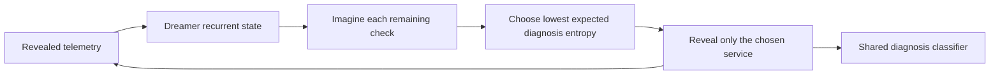

# Active diagnostic observation results — 17 November 2026

**Exploratory gate: NOT MET. Full-information diagnosis ceiling: not met.

Fresh RCAEval RE2-TT (Train Ticket): 60 training and 30 held-out incidents, with no timestamp exclusions. Five candidate root services define five possible checks. Each check reveals one service’s aggregate telemetry from a recorded post-fault window. This is offline observation acquisition, not a live intervention.

Every method uses the same training-only ridge classifier; only the order of checks changes. The Dreamer acquisition controller is an explicit one-step lookahead over learned dynamics, not the native actor. No unqueried actual values or test labels are used in choosing an action.

## Accuracy by observation budget

Values are percentages over the same 30 incidents. Random-order results average 16 repeats per incident; this does not create 480 independent incidents.

| Method | 1 check | 2 checks | 3 checks | 4 checks | 5 checks | Mean, checks 1–4 |
|---|---:|---:|---:|---:|---:|---:|
| Dreamer seed 42 | 43.3% | 60.0% | 76.7% | 86.7% | 93.3% | 66.7% |
| Dreamer seed 43 | 46.7% | 56.7% | 86.7% | 90.0% | 93.3% | 70.0% |
| Fixed alphabetical | 40.0% | 63.3% | 86.7% | 93.3% | 93.3% | 70.8% |
| Retrieval adaptive | 36.7% | 63.3% | 70.0% | 86.7% | 93.3% | 64.2% |
| Random order | 39.6% | 57.9% | 75.0% | 90.0% | 93.3% | 65.6% |

## Check efficiency

Minimum fixed budget whose accuracy is within one correct incident of the all-five-check classifier. This summarizes an accuracy curve; it is not a learned stopping policy.

| Method | Minimum fixed budget | Within one case by 3 checks |
|---|---:|---|
| Dreamer seed 42 | 5 | False |
| Dreamer seed 43 | 4 | False |
| Fixed alphabetical | 4 | False |
| Retrieval adaptive | 5 | False |
| Random order | 4 | False |

## What was learned and controlled

DreamerV3 size1m was trained from scratch for 64,000 environment steps per seed, using random full permutations of service checks. The world model receives the executed action in recurrent state, predicts action-conditioned latent transitions, and has a training-only diagnosis head. The acquisition controller samples 32 imagined next states per candidate check and minimizes their mean diagnosis entropy. All training rewards are zero. The actor’s output is overridden during training and is not the evaluated controller.

The shared diagnosis classifier was fitted to all 32 subsets of the 60 training incidents with ridge penalty 100. Fixed and random orders are references. The retrieval strategy uses distances and labels of training incidents to estimate the expected information from each next check. Its decisions cannot access the current incident’s hidden values. Non-Dreamer predictions and the shared classifier hash match exactly across seeds.

Metrics are restricted to the five services that appear as root causes in training. This excludes unknown-service diagnosis. The observed values are averages of normalized metrics across five minutes after known fault onset. No claim is made about detection latency, system evolution under real interventions, adaptive stopping or automatic repair.

## Prespecified decision

The primary metric averages accuracy at budgets 1–4. A useful signal requires a gain of at least 5 percentage points over fixed and retrieval-adaptive acquisition in each seed, with all-five-check accuracy at least 29/30. Random order is an additional reference. This is a small exploratory threshold, not statistical proof. No thresholds or controller settings were changed after scoring.

## Audits and operations

Sixteen focused local checks passed, including hidden-observation isolation, distinct queries, shared-classifier behavior and frozen-file rejection before label access. A short functional smoke check used a training incident only. Both full models passed the actual encoder/decoder/policy label-isolation audit. Each recorded check sequence has exact budget coverage, no repeats, and the same full-information diagnosis as all other methods.

All cluster work remained in systems-world-model-lab under existing quota and default-deny networking. The original inference deployment was restored, five services are healthy, and experiment pods were removed. Checkpoints remain on the results PVC; no candidate was promoted.

## Runtime

| Seed | Training seconds | Evaluation seconds | Training inspection episodes |
|---|---:|---:|---:|
| 42 | 665.2 | 19.7 | 10667 |
| 43 | 670.5 | 18.2 | 10667 |

[Frozen protocol](RCAEVAL_ACQUISITION_PROTOCOL.md) · [Scored curves](evidence/rcaeval-acquisition-v1/scores.json) · [Frozen hashes](evidence/rcaeval-acquisition-v1/frozen-hashes.json) · [Restoration](evidence/rcaeval-acquisition-v1/restored.json)

## Interpretation and decision

Across budgets 1–4, Dreamer scored 66.7% and 70.0%, compared with 70.8% for the fixed order, 64.2% for retrieval-adaptive checking, and 65.6% for random checking. Dreamer exceeded the retrieval comparator, but the improvement was not consistent enough across both seeds to meet the declared margin, and neither seed beat the fixed order. This is not a demonstrated observation-efficiency gain.

The fixed order reached the shared classifier's 28/30 result after four checks. Dreamer reached 26/30 and 27/30 after four checks and needed all five to reach 28/30. Its descriptive within-one-case budget was five and four checks, versus four for the fixed order. These small results do not establish that all world-model acquisition methods would fail; they reject the benefit claim for this configuration.

Both unavoidable full-information mistakes were packet-loss incidents: `ts-auth-service` was attributed to `ts-order-service`, and `ts-travel-service` to `ts-train-service`. Because all methods use the same classifier, these two errors cannot be fixed by changing check order once all observations are revealed. The shared 28/30 ceiling is below the prespecified 29/30 reliability target.

All initial observation vectors are identical. Variation in Dreamer's first chosen check across incidents is therefore sampling variation, not case-specific reasoning from evidence. Later decisions may use revealed observations, but the observed accuracy curves do not show an overall advantage over the fixed order. We have not measured whether imagined next observations or entropies are calibrated; incorrect forecasts are a hypothesis to investigate, not an established cause of this outcome.

Before another confirmation run, use development incidents to audit imagined check outcomes against actual observations and examine whether predicted information gain tracks real diagnostic improvement. Keep this test set and its results frozen. No model promotion is justified. Each check has unit cost in this benchmark; real query latency and time to resolution were not measured.

The job completed in 23 minutes 44 seconds, including its training-only smoke check and evaluations. A transient SSH outage interrupted the external monitor; the same training job continued without restart. Monitoring resumed with retries, outputs were archived, and deployment restoration was verified. All 58 deployed upstream source files were hash-matched to the pinned revision; see the source audit.
